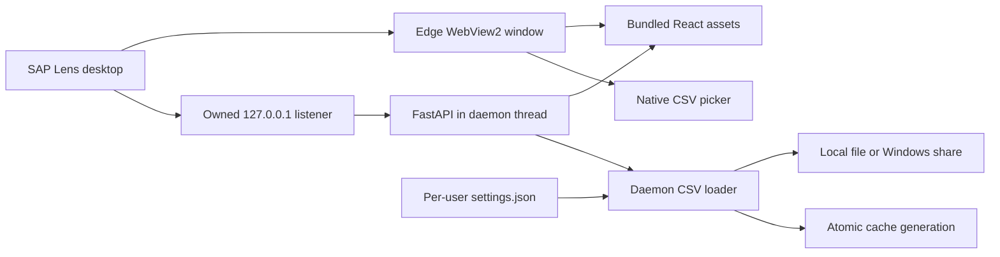

# Architecture and performance

The desktop launcher first acquires the per-session Windows named mutex. Secondary launches activate the existing window without probing a socket. It then reserves a loopback listener, preferring `18743` and falling back to an OS-assigned port if needed. It starts an in-process Uvicorn daemon thread against that socket, waits for API readiness, then opens the branded WebView2 window. Closing the window owns service shutdown; no detached service subprocess can survive the EXE.

`create_app` receives the actual selected origin, a random per-launch capability and an instance identity. Desktop CORS permits exactly that origin; both API reads and writes require the capability. The capability is bootstrapped via a fragment, removed from the URL and kept in the private window's session storage to support reload. Only non-secret instance diagnostics are written to `runtime.json`. The native bridge exposes only a guarded CSV picker.

Initial CSV loading is asynchronous and does not block API/window startup. A daemon loader thread builds a new cache; canceled loads check cancellation before publication/settings writes. The UI polls settings only while loading, displays its state, then invalidates role queries. A slow filesystem can still delay a load, but cannot keep Python alive after app shutdown. Mutations use the same daemon-load helper rather than asyncio's non-daemon default executor. Only one load is accepted at a time; callers receive an understandable busy response instead of queuing unbounded reads.

## Cache and bundle improvements

The streaming standard-library CSV reader replaces pandas/dataframes and intermediary row-dictionary copies. Pandas/numpy are no longer runtime dependencies. Each complete cache generation contains details, precomputed summaries/counts, module labels and a reverse T-code index. Readers retain one snapshot per request, so a refresh cannot mix generations or leave the T-code index stale. File-location persistence happens only after CSV validation and before publication. Failures retain the previous data/settings.

Comparison work is bounded to two to five roles. Prefix T-code search still scans index keys; memory still scales with the complete role graph, including overlap assignments. No dataset-size sandbox is claimed. CSV loads are serialized to prevent refresh storms.

The frontend uses same-origin native fetch instead of Axios, no Google Fonts and no offline service worker. The measured production JavaScript is approximately 312 kB (95 kB gzip), with the settings/picker UI included. Browser test dependencies stay in development tooling and do not enter the frontend bundle. React Query retains role data in memory; changing the CSV resets lists, details and comparisons and clears role selection.

## Development and verification

Vite uses `127.0.0.1:18743` and proxies API requests to a backend at `18744`. Production uses FastAPI-served assets on the owned desktop origin. The source-mode API remains available for development with the custom mutation header and explicit loopback CORS. Desktop capabilities are supplied by the launcher, not a production environment variable.

Regression tests run the actual HTTP server/lifecycle with mocked native boundaries, including repeated launch/close and an unrelated occupied port. Playwright tests load the production assets with session enforcement, stub only the picker bridge and verify reload, errors, configuration and absence of external requests. The Windows workflow separately builds and launches the packaged EXE. The real picker, WebView2 UI, OS mutex/focus behavior and clean-PC prerequisites still require Windows validation.
