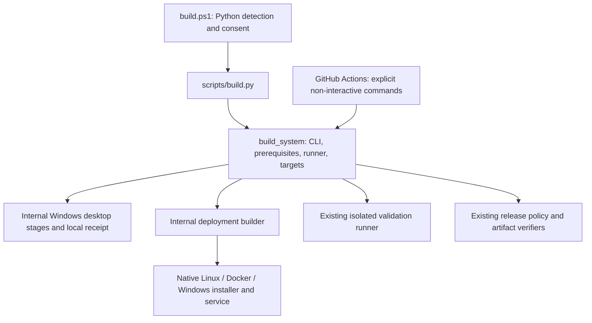

# SAP Lens build system

The public interfaces are `build.ps1` (Windows bootstrap) and `scripts/build.py`
(Python CLI on Windows/Linux). Both use the same Python engine. No command publishes
an image, changes `main`, bumps the product version, creates a tag or publishes a
release by default. **Release mode prepares and verifies artifacts only.** Actual
publication stays in the existing explicitly dispatched, branch-guarded workflow.

## Architecture



The engine owns modes, input, prerequisites, consent, routing, logging and exit
codes. Specialized scripts remain internal owners of compilation, installers,
service management, platform-specific receipts, immutable identity and verification.
It does not duplicate PyInstaller or implement a second installer/release system.

| Internal consumer | Existing implementation reused |
| --- | --- |
| Windows portable adapter | `build-local.ps1` → `build-windows.ps1` → PyInstaller, PE verifier, EXE smoke and local ZIP verifier |
| Deployment adapter | `build-deployments.py` → shared receipts → Windows package, native and Docker utilities |
| Windows installer/service | `package-windows-deployment.ps1`, `build-desktop-installer.ps1`, `build-server-windows.ps1`, `build-service-manager.ps1` |
| Tests and CI timing | `validate.py`, `run-tests.py`, `ci.py`, workflow contracts |
| Release preparation/publication guards | `deployment-release.py`, `release-windows.py` and artifact verifiers |

These have actual engine/CI consumers and remain internal; they are not obsolete
copies of the public interface.

## Prerequisites

- CLI: Python 3.12+ and standard library only for initial parsing/detection.
- Actual project setup/build/test environments: **Python 3.12 x64**, matching the
  locked and validated toolchain. Newer Python can show help/plan/Quick but is not
  certified for packaging or dependency setup.
- Git; Node/npm when required. Node uses `frontend/package.json`'s compatible engine
  range (currently 24/25); npm 10/11. Package installs use existing Python requirement
  pins and `npm ci`, never arbitrary dependency upgrades.
- Windows x64: PowerShell 5.1 or 7; WebView2 for desktop runtime smoke checks.
  Service-manager compilation requires .NET Framework 4.8.
- Native Linux packaging: Linux x86-64 and Python 3.12/system libraries from the
  [native guide](deployment/LINUX_NATIVE.md). Linux native and Docker packaging are
  Python-only and do not require PowerShell. If `pwsh` happens to be installed, the
  shared validation also parses the Windows scripts; without it that one check is
  recorded as *not verified* in the local receipt (never as passed). Windows hosts and
  CI always run it. No Windows binary is built on Linux.
- Docker: a running Linux amd64 Docker engine and `docker compose`.

Detailed Windows installation, PATH, proxy/CA and tool checks live in
[Windows build toolchain](development/DEVELOPMENT.md#windows-build-toolchain).
Destination installations do not need Node or React compilation. Existing package
contents, service names, installation paths, binding/security and data storage stay
unchanged; see the [deployment guides](deployment/README.md).

### Prerequisite matrix

| Prerequisite | Needed for | What the build entry points do | Manual or administrator action |
| --- | --- | --- | --- |
| Python 3.12 x64 | build, test, package | Checked (version and 64-bit); `build.ps1` offers a per-user winget install only with consent | Install it yourself on other platforms |
| Project `.venv` / packaging env | test, build, package | Created if missing; reused if valid; a wrong-version, 32-bit or broken one is reported and **never deleted** | Remove or repair it yourself when told |
| pip | all Python setup | Seeded if missing; upgraded to the pinned release when older than 24.2 (see below) | None normally |
| Locked Python dependencies | test, build, package | Installed from the pinned requirement files only when something is missing or different; otherwise skipped | None |
| Node.js 24/25 and npm 10/11 | frontend, build, package | Checked only; per-user winget install on Windows with consent; **never replaces your global Node** | Install a supported version when missing |
| Locked frontend dependencies | frontend, build, package | `npm ci` only when `node_modules` is older than `package.json` or the lockfile | None |
| Git | release, packaging identity | Checked; per-user winget install with consent | Elsewhere install it yourself |
| Docker engine and Compose | Docker target | Checked only | Install and start it yourself |
| PowerShell 5.1 or 7 | Windows targets | Checked on Windows; not needed for Linux or Docker packaging | None on Windows |
| Inno Setup, .NET Framework 4.8, WebView2 | Windows installer, service manager, desktop smoke | Handled by the Windows packaging scripts; see the Windows guides | Administrator approval where policy requires |

Quick checks (`quick`) install nothing. `test` prepares only the project `.venv`; `build`/`package` prepare the packaging environment; `release` needs Git only. System-level installs (Python, Git, Node) always need explicit consent (`--install-system` or an interactive yes).

**pip and certificates.** Python 3.12 seeds new environments with pip 24.0, which trusts only its bundled certificates and fails with `CERTIFICATE_VERIFY_FAILED` where a corporate proxy's CA lives in the Windows certificate store. The engine therefore moves an old pip to the project's pinned release (`pip==` in `backend/requirements-build.txt`) before installing anything; if that first step fails certificate verification it retries **once** with pip's system-trust-store option (`--use-feature=truststore`), only for this bootstrap, because pip 24.2 and later use the system store by default. Verification is never disabled, `--trusted-host` is never used, and no certificate is added to the machine. If the system store does not contain the CA, ask IT to trust it there (or `pip config set global.cert <file>`) and rerun; repeated runs resume safely.

## First-time Windows setup

From an approved checkout, in x64 PowerShell:

```powershell
.\build.ps1
.\build.ps1 -Mode quick
.\build.ps1 -Mode package -Platform windows -Target installer
```

The bootstrapper can start **without Python installed**. It runs every candidate and
accepts only Python 3.12.x that is 64-bit, in this order: an existing project `.venv`,
the Python launcher (`py -3.12`), `python3.12`/`python` on PATH, then other registered
installations (`py -0p`, the Windows registry). Microsoft Store app execution aliases are
skipped. Nothing is printed on success (use `-Verbose` to see the selected interpreter);
when no candidate is accepted it lists each one with the reason (version, architecture or
failed probe). Only then, interactive execution offers the official `Python.Python.3.12` winget package with
an explicit confirmation. It requests per-user/x64 installation, verifies the
result, and never silently falls back to a machine-wide/elevated installer.

For explicit unattended consent use `-InstallSystem -NonInteractive`. Ordinary
non-interactive/CI runs do not install system software and never prompt. Missing
winget, policy restrictions, unsupported per-user packages or stale PATH produce
manual remediation guidance. Git/Node setup similarly requires consent; Node's
winget version is selected from the supported 24 line rather than an unrelated
latest major. Docker/system services need approved manual setup.

### Corporate policy restrictions

No entry point changes execution policy or downloads/runs unchecked installers.
AllSigned/Restricted/AppLocker/WDAC environments may block the bootstrapper **before
it starts**. Obtain IT approval/signing for the reviewed root and internal scripts,
or use an approved Python interpreter for the CLI; Python does not bypass policy
on internal PowerShell packaging scripts. Do not weaken organization controls.
No system software is installed by the automated tests.

## Commands

Windows:

```powershell
.\build.ps1 -Mode quick
.\build.ps1 -Mode build -Platform windows -Target desktop
.\build.ps1 -Mode package -Platform windows -Target installer
.\build.ps1 -Mode package -Platform windows -Target service
.\build.ps1 -Mode test -Scope targeted -Area deployment
.\build.ps1 -Mode test -Scope full -NonInteractive
```

Linux / direct Python:

```sh
python3.12 scripts/build.py
python3.12 scripts/build.py quick
python3.12 scripts/build.py package --platform linux --target server
python3.12 scripts/build.py package --platform docker --target server
python3.12 scripts/build.py test --scope targeted --area deployment --skip-setup --non-interactive
python3.12 scripts/build.py test --scope full --non-interactive
```

Interactive terminals prompt only for missing required values. With no mode, the
menu defaults to Quick; an empty answer accepts the displayed default. Mode,
platform, target and scope input are case-insensitive. Complete arguments execute
directly. Non-interactive execution defaults to Quick/current host and never reads
stdin. GitHub Actions is always treated as non-interactive.

## Modes

| Mode | Behavior |
| --- | --- |
| `quick` | Offline/read-only source/version/manifests, docs, ownership and whitespace checks; no installs, builds or regression by default |
| `test` | Existing isolated validation runner; targeted deployment area by default; `--area` selects another existing area |
| `build` | Compile/package the selected application through canonical platform adapters |
| `package` | Produce verified distributable archives through the same adapters; `--skip-setup` requires fresh validated inputs, never an unchecked skip |
| `release` | Verify validated deployment artifacts from `--output`, branch/source/version and workflow contracts; no tag or publication |
| `clean` | Only allowlisted generated directories, with `--confirm-clean`; refuses active locks, links, arbitrary output paths and the running interpreter |

Full regression is opt-in **test mode only**, not a build/publication prerequisite.
`--dry-run` prints the commands without setup, installs, logs, deletion or build
execution. Platform restrictions still apply; there is no cross-compiler.
`--verbose` displays captured tool output. Local runs store structured events and
per-operation logs under ignored `backend/build/unified/<run-id>/`. CI preserves
native step output and existing timing/summary artifacts.

## Targets

| Platform | Targets | Canonical result |
| --- | --- | --- |
| `windows` | `desktop` | Existing portable EXE/ZIP, PE/privacy/checksum and native EXE smoke verification |
| `windows` | `installer` | Existing current-user Inno Setup deployment archive; no service requirement |
| `windows` | `server` / `service` | Same headless runtime + verified WinSW + service manager package |
| `windows` | `all` | Installer/desktop payload plus service, sharing validated inputs |
| `linux` | `server` / `service` / `all` | Native x86-64 server package with systemd installer and pinned wheelhouse |
| `docker` | `server` / `all` | Existing amd64 image archive + Compose deployment; never a registry push |
| `all` | `all` | Existing four deployment archives using explicit trusted remote builders where required |

There is no Linux desktop GUI or Linux installer executable. Unsupported
combinations fail before packaging. Windows Portable Desktop needs Windows;
remote Windows builds use the installer target. Desktop stays `--windowed`;
the separate headless service host retains console shutdown semantics.

## Setup and repair

```sh
python3.12 scripts/build.py --setup-only --non-interactive
python3.12 scripts/build.py test --setup --area deployment
python3.12 scripts/build.py quick --skip-setup --non-interactive
```

Setup creates/reuses project `.venv`, ensures pip, installs pinned development
requirements and uses `npm ci`. Packaging environment preparation remains owned
by the canonical platform adapter under `backend/build/python-env`; explicit
setup-only in build/package mode prepares that environment. No global pip
installation is used. Incompatible/incomplete environments fail with repair
instructions rather than deleting user files. `--setup` explicitly repairs local
dependencies; `--skip-setup` forbids bootstrap and fails if required inputs are
missing. Reusing compiled inputs additionally requires their existing fresh,
source/tool/version-bound receipt. System tools still need separate explicit
consent (`--install-system` or an interactive Yes).

## Output layout

All distributable output is written under the repository-root `dist/`, which Git ignores completely (`/dist/`) and the Docker allowlist context never includes; temporary work and logs stay in `backend/build`, `frontend/dist` and `build/`. `scripts/build_system/layout.py` is the single description used by the clean command and the layout tests:

| Directory | Holds |
| --- | --- |
| `dist/local/` | Portable Windows desktop builds, run records and receipts |
| `dist/deployment/` | Verified deployment archives and checksums: Windows desktop and service, Linux native, Docker image archive |
| `dist/server/` | Windows service distributions |
| `dist/<version>/` | Per-version output of the cross-platform builder, with its manifest and `SHA256SUMS.txt` |
| `dist/publication/` | Same-run artifacts collected by the guarded release job (never written locally) |

Docker images stay in Docker; only exported archives and metadata land in `dist/`. The package folders were not split further by platform because the GitHub upload contracts, release collection and verification read these exact paths; the platform is part of each package name. `clean` removes only the generated locations above plus `backend/build`, `backend/dist` and `frontend/dist`, refuses symbolic links and Windows junctions anywhere on the path, requires `--confirm-clean`, and never touches sources, user data or databases.

## Outputs and versioning

`backend/resources/product-version.json` remains authoritative through
`backend/version.py`. `--version` is an intentional test override, never a version
bump. Existing dotted prereleases and legacy portable beta-hyphen overrides remain
supported; deployment archives retain their established SemVer requirements.

Deployment archives default to `dist/<version>/`; `--output` can select another
verified managed/ignored or external output directory. Portable Windows exports
retain `dist/local/packages/<local-version>/<run-id>/`; a portable output override
must remain under `dist/local/`. No output is silently overwritten. Each successful
command prints its canonical manifest/artifact location and log directory.

| Target | Existing archive name |
| --- | --- |
| Windows installer | `sap-lens-win-desktop-x64-v<version>.zip` |
| Windows service | `sap-lens-win-service-x64-v<version>.zip` |
| Linux native | `sap-lens-linux-native-x64-v<version>.tar.gz` |
| Docker | `sap-lens-linux-docker-amd64-v<version>.tar.gz` |
| Portable Windows | `SAP-Lens-Windows-x64-<version>+local.<sha>.zip` |

Installer payload: `SAP-Lens-Windows-Desktop-x64-<version>-Setup.exe`. Existing
checksums, exact contents, same-source identity and extraction/native verification
are retained. Release attachment policy is unchanged: no duplicate loose SHA256
release assets. Partial/failed output is not success; consult the operation exit
code and manifest rather than selecting an old executable.

## Remote builders

Use `--windows-host/--windows-repository` or `--linux-host/--linux-repository`
for an explicitly configured trusted SSH builder with a clean checkout of the
exact same commit. Existing strict host-key checking, source matching, nonce and
artifact/hash verification are retained. Hosts/keys are administrator setup, not
auto-installed or inferred by SAP Lens.

## Release preparation and CI

```sh
python3.12 scripts/build.py release --platform linux --target server --output dist/<version> --non-interactive
```

Prereleases prepare from `work`; stable preparation is rejected unless on `main`.
Artifacts must match the selected version, source and targets. No tags/releases
are created locally. Actual publishing still requires the existing manual workflow
and all selected packages to pass, with source/branch/tag/collision protections.
See [release policy](deployment/RELEASES.md).

Existing Actions now invoke this engine explicitly without prompting, for example:

```yaml
- name: Package Windows service
  run: python scripts/build.py package --ci-tool windows-package --non-interactive -- -Target Service
```

`--ci-tool` is a CI-only adapter boundary, not a local bypass. Setup actions and
same-run attestations remain authoritative; ordinary local setup cannot mint CI
receipts. Fast/Full timing runners and platform/release adapters reuse the existing
helpers through this entry point. Permissions, job independence, setup actions,
version allocation and artifact names are unchanged. No workflow is dispatched by
this guide. Full remains manual and is not a release prerequisite.

## Cleanup and internal scripts

```sh
python3.12 scripts/build.py clean --dry-run --non-interactive
python3.12 scripts/build.py clean --confirm-clean --non-interactive
```

Only `backend/build`, `backend/dist`, `frontend/dist`, `dist/local` and
`dist/deployment` are allowlisted. `.venv`, installations, configuration, snapshots
and user data are preserved. Active build/cleanup locks block deletion. Stale
locks require ownership review; clean never breaks an active owner's lock.

The duplicate root Bash wrapper was removed after migrating its active caller.
Use Python directly on Linux. Specialized internal Windows/local/deployment,
installer, validation, runtime and release helpers remain because the engine or
CI adapters actually call them. They are not alternative documented build front
doors. The old deployment build-guide URL is a navigation stub for existing links,
not a competing set of instructions.

## Exit codes and troubleshooting

- `0`: completed operation (or dry-run/help); `2`: arguments/configuration/unsupported
  combination; `3`: missing/incompatible prerequisite, denied setup or lock ownership.
- Child tool failures retain their exit code; timeout is `124`. Nonzero always means
  failure. Logs identify the operation and captured diagnostics.
- Missing Python: read the `Python discovery:` list the bootstrapper prints for every rejected candidate. If none is
  listed, use approved Python 3.12 x64/winget and reopen PowerShell. An existing `.venv` that is not 3.12 x64 is reported
  and left untouched; remove or repair it yourself.
- Missing/incompatible Node: install the project-supported version; do not install
  an unrelated latest major. A failed per-user winget install has no admin fallback.
- Missing Docker/Compose: use approved manual platform setup. PowerShell is needed only for Windows targets.
- Stale receipt: rebuild without `--skip-setup`, on the exact clean commit.
- TLS/proxy or audit failure: use approved trust settings and resolve the advisory;
  never disable verification or ignore audits to finish packaging.
- Corporate policy blocks a script: obtain signing/IT approval, not a policy bypass.

## Validation status

CLI/routing/consent/error/cleanup behavior and package/workflow contracts are tested
with isolated synthetic fixtures and mocked system installers. Python Quick is
executed locally. Real Windows bootstrap, winget, PowerShell 5.1/7 execution,
PyInstaller/Inno/.NET compilation, WebView2/SCM and current-source platform packages
remain unexecuted on this Linux host. No full application regression is claimed.
See the [workflow validation matrix](validation/WORKFLOW_MATRIX.md) and the
[platform acceptance matrix](deployment/README.md#validation-status).

## Script inventory (audit of 2026-11-04)

All 54 tracked files under `scripts/` were audited for purpose, callers (workflows, tests, documentation) and overlap with the Python engine.
Result: **no script was removed and none migrated**. Every file has a live caller or a documented role, and the apparent overlaps are layered
(a public wrapper over an internal worker) rather than duplicated. Public entrypoints are `build.ps1` and `scripts/build.py`; everything
else is an internal helper and is not a supported entrypoint.

| Group | Files | Disposition | Purpose |
| --- | --- | --- | --- |
| Public entrypoints | build.ps1 (root), build.py, build_system/* | KEEP | Windows bootstrapper and the shared Python engine (CLI, prerequisites, runner, targets) |
| Orchestrators | build-deployments.py | KEEP | Deployment builder: shared validation, Windows/Linux/Docker packages, remote builders; called by the engine and workflows |
| Orchestrators | local-build.py, build-local.ps1 | KEEP | Portable Windows desktop local build (receipt, ZIP verification); called by the engine |
| Orchestrators | build-windows.ps1, release-windows.py, write-build-report.py | KEEP | Legacy Windows desktop workflow stages, version reservation/release gate and run report (build-windows.yml) |
| Orchestrators | package-windows-deployment.ps1 | KEEP | Windows desktop/service packaging steps shared by local and CI builds |
| Windows helpers | build-desktop-installer.ps1, build-server-windows.ps1, build-service-manager.ps1, manage-server-service.ps1 | KEEP | Inno installer, service bundle, service-manager compile and the shipped service management script (need Windows/.NET) |
| Windows tests | test-windows-exe.ps1, test-desktop-installer.ps1, test-server-service.ps1 | KEEP | Native EXE, installer and service smoke tests run by the packaging scripts |
| Windows tests | test-service-management.ps1 | KEEP (debt) | Portable service-helper regression test; only parse-checked by check-powershell.ps1 and not executed by any build step. Wire it into the service stage on a Windows host before relying on it |
| Linux/Docker | deployment-package.py, install-linux-server.py, run-installed-server.py, test-native-deployment.py | KEEP | Native Linux archive, installer, runtime launcher and offline install smoke test (Python only) |
| Linux/Docker | package-docker.py, test-docker-deployment.py, test-docker-lifecycle.py | KEEP | Docker image archive and its runtime/persistence smoke tests |
| Release | deployment-release.py, check-deployment-download.py | KEEP | Plan/preflight/publish gates and downloaded-artifact check for the deployment workflow |
| Verification | verify-windows-package.py, verify-server-bundle.py, verify-desktop-installer.py, verify-desktop-distribution.py, verify-artifact-zip.py, write-windows-metadata.py | KEEP | Package, bundle, installer and ZIP verifiers; version/PE metadata generation |
| Validation | validate.py (+ validate.sh, validate.ps1), run-tests.py, test-map.json, ci.py, check-workflows.py, check-docs.py, check-powershell.ps1 | KEEP | Validation levels and their thin wrappers (documented in AGENTS.md), test profiles and ownership, CI step runner/summary, workflow contracts, documentation links, PowerShell parse check |
| Validation | serve-browser-tests.py, sync-lucide-catalog.mjs, frontend-licenses.mjs, product-version.mjs, requirements-audit.txt | KEEP | Browser test server, icon catalogue check, license and version generators, audit tooling pins |
| Development | validation_tracker.py, generate-examples.py, profile-sod.py, reference-template.py | KEEP | Tracker tooling, deterministic example generator, SoD profiling and reference template; separate from the build engine by design |

Remaining debt: `test-service-management.ps1` is not executed by any build step; the legacy `build-windows.ps1` stage engine and the deployment
builder still own sequencing that could later move into Python, which needs real Windows parity testing first.

## Manual build

Open Actions → **Build Deployment Packages** → Run workflow, select the intended
branch (normally `work`), then choose one **`build_target`** (a single dropdown; every
choice is valid):

| `build_target` | Builds |
| --- | --- |
| `all` (default) | All platforms, all four packages |
| `windows-all` | Both Windows packages: Windows Desktop and Windows Server Service |
| `windows-desktop` | Windows Desktop only |
| `windows-service` | Windows Server Service only |
| `linux-all` | Both Linux packages: Linux Docker and Linux Native/systemd |
| `linux-docker` | Linux Docker only |
| `linux-native` | Linux Native/systemd only |

The first job, **Resolve Build Selection** (about a minute, no dependencies installed),
resolves the choice once and exposes the selected packages. An unknown value (possible
only through a manual API dispatch) fails there with a message listing the valid values,
before shared validation or any packaging runner starts. Unselected packages are skipped
jobs: no Windows runner starts for a Linux target and no Linux packaging runner for a
Windows target. The job summary shows the selected target, the resolved packages, every
package as selected or skipped, the version and channel, and whether publication is
enabled. Artifact names and the per-package jobs are unchanged.

Leave base `version` empty to use the source product version, choose a `release_channel`, and use
`prerelease_number=auto` to derive the next sequence from tags and release metadata. Publication is controlled separately by
`publish_release`, **false by default**. All selected artifacts embed the same
resolved version, source commit and workflow run/attempt.

| Channel | Example |
| --- | --- |
| Alpha | `1.0.0-alpha.1` |
| Beta | `1.0.0-beta.1` |
| Release Candidate (RC) | `1.0.0-rc.1` |
| Stable / Production | `1.0.0` |

Base components and prerelease numbers are limited to 65535 for Windows PE
compatibility. Leading zeros, suffixes in the base, invalid channels and malformed
numbers are rejected. Stable ignores a valid supplied sequence; leaving it blank
is supported. Automatic numbering counts both legacy `beta-N` and SemVer `beta.N` tags (including drafts). Published identities are never renamed or reused. Explicit publication numbers must equal the next available sequence.

With `publish_release=false`, only Actions artifacts are created: **no tag or
GitHub Release**, even for a Stable version. An embedded version/tag name is
candidate metadata, not proof of publication. No binary signing or registry push
is enabled. Existing **Build Windows Application** retains its independent,
legacy desktop build/beta/stable release behavior unchanged.

With `publish_release=true`, every selected package must finish its native
packaging and artifact roundtrip successfully. Only then can the isolated,
write-scoped publisher collect those exact same-run artifact IDs, verify their
names/checksums against successful job outputs, stage a draft, verify every
uploaded release asset's server-side SHA-256, create an owned annotated version
tag and publish. Alpha/Beta/RC are prereleases; Stable is a normal/latest release.
All selected packages, checksum sidecars and a source/digest manifest are attached.
A failed, skipped or cancelled selected package prevents publication. Packages that
were not selected are skipped by design: they never block publication, and they are
never collected. The publisher takes the package list from the planning job, checks it
against a fresh resolution of the same build target, and refuses to publish if an unselected
package ran. Only same-run artifact IDs of selected, verified packages are downloaded;
nothing is reused from earlier runs. Build-only runs still upload successful
independent packages when a sibling fails.

Publication asks GitHub to generate release notes from repository history, keeping
the validated-package/source explanation as the prefix. Authorized maintainers can
review/edit the published notes using GitHub's Release editor. The workflow does
not pause its private draft for manual editing; use existing environment approval
before publication. Build-only mode creates neither a draft nor release notes.
GitHub Releases remains the release-history record; no CHANGELOG.md is used.

### Examples after workflow registration

For test packages: select build target `all`, source base (empty input), `Beta`, sequence `auto`, and leave
**Publish release unchecked**. Download each successful job's Actions artifact.

For a Beta release: select the desired build target, source base (empty input), `Beta`, sequence `auto`, and explicitly check **Publish release**.

For Stable: first promote reviewed changes and stable product metadata to `main` through a PR; select that main commit, the desired target (normally `all`), source base (empty input),
`Stable / Production`, and explicitly check **Publish release**. Existing
`sap-lens-stable` environment protection applies; prereleases use `sap-lens-beta`.
No repository/environment settings are modified by these source changes.

The CLI equivalent for a build-only run, **after the workflow is registered**:

```bash
gh workflow run build-deployments.yml --repo OnlyDrey/sap-lens --ref work \
  -f build_target=all -f version=1.0.0 -f release_channel=Beta \
  -f prerelease_number=1 -f publish_release=false
```

Do not run publication commands without approval. Actions artifacts have the
configured retention period and an outer GitHub ZIP wrapper; release assets are
the actual deployment archives/sidecars and remain attached until explicitly
removed. This implementation does not publish anything during local development.

### Failure and concurrency safety

A read-only preflight rejects existing tags/releases before shared validation;
the publisher checks again after all packages pass. Existing refs/releases are
never overwritten, adopted or force-updated. Draft assets are uploaded before
tag creation. Publication is serialized independently across branches. A normal
failure removes only this invocation's draft and its provably owned annotated
tag; foreign tags and published releases are never removed. A lost successful
publish response is reconciled once without retrying publication.

GitHub does not offer a transaction spanning all release/tag calls. If remote
state cannot be read during recovery, cleanup stops and reports manual
reconciliation rather than guessing or deleting uncertain state. Inspect the
release, owned tag and run summary before a new dispatch. Do not blindly retry a
failed version or delete a pre-existing reservation. Mocks validate this policy;
live GitHub publication/rollback has not been exercised in this task.

This workflow is registered on the default branch as well as `work` (registration
was verified on 25 October 2026). No merge or default-branch change is needed merely
to select `work`. The GitHub form may reflect the default branch's older inputs;
CLI/API dispatch with an explicit `ref` selects the intended branch definition.
Always inspect its inputs and use the matching source version. No dispatch is
performed automatically by these instructions.

Shared validation runs once per dispatch: backend/browser regressions, types,
production frontend, audits, workflow/PowerShell checks. Its frontend and identity
are sealed with hashes, source SHA, run/attempt and successful stage records.
Platform jobs accept only this same-run/attempt attestation. If GitHub reruns only
failed platform jobs under a new attempt, the prior attestation is deliberately
not accepted; an approved full rerun must regenerate shared validation. Each needs only shared
validation, so one platform failure cannot cancel or block another platform's
upload. A shared validation failure appropriately prevents all packaging.

## Outputs

Actions artifact names use the same stem as their inner archive:

| Platform | Inner deployment file |
| --- | --- |
| Windows Desktop | `sap-lens-win-desktop-x64-v<version>.zip` |
| Windows Service | `sap-lens-win-service-x64-v<version>.zip` |
| Linux Docker | `sap-lens-linux-docker-amd64-v<version>.tar.gz` |
| Linux native/client | `sap-lens-linux-native-x64-v<version>.tar.gz` |

After the selected job and roundtrip succeed, open the completed Actions run's
**Artifacts** section and download the selected platform stem. Alternatively, use
`gh run download <run-id> --repo OnlyDrey/sap-lens --name <artifact-name>` for an
authorized run. Downloading is not a build or publication action.

Every artifact contains its archive plus `<archive>.sha256`, retained for 14 days.
Published releases contain only the selected archives and `sap-lens-manifest.json`;
individual sidecars remain internal verification inputs. GitHub displays the SHA-256
digest for each uploaded asset, and the manifest records source identity and archive
sizes/digests. No separate checksum list is uploaded. Existing releases are not changed.
To verify a download, compare `sha256sum <archive>` on Linux or
`Get-FileHash <archive> -Algorithm SHA256` on Windows with the digest shown by GitHub
or recorded for that archive in `sap-lens-manifest.json`.

For Actions downloads, GitHub wraps these files in another downloadable ZIP: extract that wrapper first.
The workflow downloads each upload again, checks its digest, inner checksum,
exact expected members and hashes. Desktop additionally uses its existing EXE/ZIP
verifiers; Service includes its PE/resource report and native SCM smoke result.

The desktop deployment ZIP now wraps the unchanged portable EXE/checksum with a
per-user Setup executable/checksum, license notices, installation guide, exact
manifest and native installer receipt. Its portable verifier still enforces its
exactly-two-file ZIP contract. See [desktop installation](deployment/WINDOWS_DESKTOP.md).
This installer definition has not been compiled or accepted on Windows in the
Linux development environment. The separate legacy Windows release artifact
remains the portable pair; it is not silently changed into an installer release.

Docker packages include an offline image, Compose configuration and the
[managed lifecycle entry point](deployment/LINUX_DOCKER.md). Native packages
include their installer and offline wheelhouse. No target needs Node.js or React
compilation; native Linux explicitly requires Python 3.12 and venv support.

Server archives contain `package-manifest.json` with per-file hashes and build
identity. Windows Service includes pinned WinSW and its MIT license. Native
includes a hash-locked wheelhouse with dependency licenses; frontend production
license notices are included in compiled assets for all platforms. SAP Lens is proprietary under [LICENSE.md](../LICENSE.md); third-party
notices do not grant rights to redistribute the application.

Only production application inputs and explicit deployment files are packaged.
CSV exports, snapshots, settings, secrets, test results, virtualenvs and Git history
are excluded. Target configuration is generated at install time; it must not be
prepopulated with an organization's data or access secrets.


