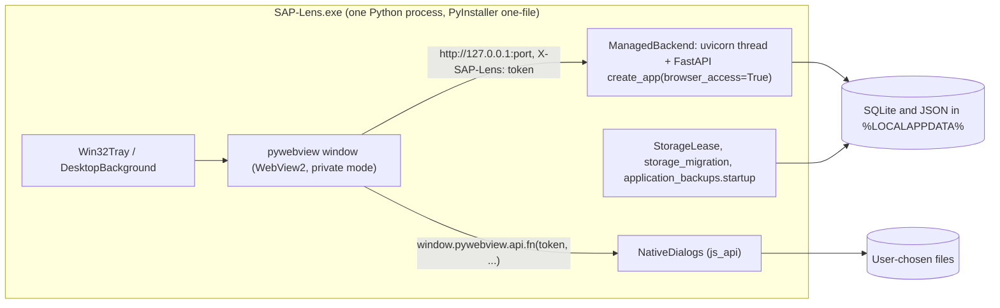

# Desktop host: verified current architecture

Status: analysis only (no application change). Evidence is the repository at `dc52746`. **[V]** marks behaviour read from source or tests,
**[A]** an assumption that still needs checking, **[P]** a proposal (see the [.NET host proposal](DESKTOP_HOST_DOTNET_PROPOSAL.md)).
Older prose in [DESKTOP.md](DESKTOP.md) was cross-checked, not trusted.

## 1. Shape of the running Desktop application [V]

The Desktop application is **one Python process**. `backend/desktop.py:run()` creates a pywebview window (`gui='edgechromium'`, `private_mode=True`),
and in the same process `ManagedBackend` runs `uvicorn.Server` in a daemon thread (`sap-lens-api`) on a listener the process reserved itself.
There is no backend child process: process ownership, shutdown and cleanup are the lifetime of that one process. The packaged form is a PyInstaller
**one-file, windowed** EXE (`scripts/build_system/windows/stages.py`, `--onefile --windowed`; the verifier records `format: one-file`), carrying the
React build (`frontend/dist`), `build-version.json`, resources and the icon. The headless Windows Server runtime is separate (`backend/server.py`,
PyInstaller onedir, Service Manager, WinSW) and never imports `webview`.

## 2. Responsibility matrix

Columns: where it is today, the contract it enforces, whether it should move, migration risk (L/M/H) and the tests that protect it today.
"Stay" means Python; "C#" means the proposed host owns it; "Both" means a thin host part plus Python validation.

| # | Responsibility | Source and symbol | Current implementation and contract | Target | Risk | Existing tests |
|---|---|---|---|---|---|---|
| 1 | Entry point | `backend/desktop.py:run`, `__main__` (also `--maintenance`) | PyInstaller entry; `--maintenance` reuses `maintenance.cli` | C# host entry; Python gets a backend entry | M | `test_desktop.py` (51) |
| 2 | Window creation | `webview.create_window('SAP Lens', html=startup_html, js_api=NativeDialogs, 1280x850, min 900x650)` | Window shows a trusted self-contained startup document, then navigates to `origin/#session=token` | C# | M | `test_desktop.py::test_repeated_window_launch_and_shutdown`, `test_startup_document_has_brand_status_and_no_external_resources` |
| 3 | Startup / error screen | `backend/startup_screen.py:startup_html/state_script/palette_script` | CSP `default-src 'none'`, authored strings only, no exception text | Both (document is HTML; host injects states) | L | `test_desktop.py`, `test_startup_session.py` |
| 4 | Backend start, in-process | `ManagedBackend.start/_run` | uvicorn in a daemon thread, `timeout_graceful_shutdown=2`, `startup_timeout()` env bound | **New** subprocess entry in Python, supervised by C# | H | `test_desktop.py` startup, readiness and retry tests |
| 5 | Readiness | `ManagedBackend.wait_ready`, `local_http_opener` | GET `/health`, must return `app=sap-lens`, the owned `instance_id`, status in {ok, loading, needs_configuration}; no redirects, no TLS/proxy handlers, bounded | Both: host repeats the probe (same checks) | M | `test_readiness_*` (8 tests) |
| 6 | Port allocation | `reserve_listener` | 127.0.0.1 only; prefer `APP_PORT` 18743, else OS port; `SO_EXCLUSIVEADDRUSE` on Windows; never contacts a conflicting listener | Python backend keeps it (reserve and report); host never probes another service | M | `test_windows_ports.py`, `test_occupied_port_is_not_contacted_or_terminated`, `test_windows_socket_exclusivity_*` |
| 7 | Desktop session capability | `secrets.token_urlsafe(32)` in `run`; `main.py:create_app(session_token, instance_id, browser_access=True)` | Every `/api` request needs `X-SAP-Lens == token` (`hmac.compare_digest`); `stale_session` code after a restart; token reaches the page via `#session=` fragment and `sessionStorage` handoff | Stay: Python validates. Host generates or relays the token **[P]** | H | `test_startup_session.py`, `test_desktop_browser.py`, `session-recovery.spec.ts`, `startup-recovery.spec.ts` |
| 8 | Loopback boundary | `main.py local_browser_boundary` | Host header must equal the exact `127.0.0.1:port` or `localhost:port`; peer must be 127.0.0.1 or ::1; Origin allow-list; Sec-Fetch navigation gate on `/` | Stay | L | `test_desktop_browser.py`, `test_server*.py` |
| 9 | Native API surface | `backend/desktop.py:NativeDialogs` (19 methods) | Each call compares the token with `hmac.compare_digest`; see section 4 | Both | H | `test_desktop.py` native tests (about 15) |
| 10 | File dialogs and writes | `_save_csv_dialog`, `_save_document_dialog`, `choose_csv`, `choose_logo`, `save_application_backup`, `export_configuration` | Fixed filename patterns, header and size checks (32 MiB), PDF/DOCX structure checks, absolute non-symlink destination, `atomic_write`, a single picker lock | Dialog UI: C#. **Validation: stays in Python** (see proposal 5.4) | H | `test_csv_save_requires_capability_*`, `test_sod_*_native_*`, `test_native_picker_*` |
| 11 | Logging | `RotatingFileHandler(config_dir()/sap-lens.log, 2 MB x 2)`, `AppLogFilter` redaction, `StartupAttempt.event` | Redacted, no CSV content, no URL fragments | Both (host log separate, same directory, same redaction rules) | M | `test_desktop.py` log tests, `test_desktop_smoke_script.py` |
| 12 | Single instance | `backend/instance.py:WindowsInstance` (`Local\SAPLensDesktop` mutex), `activate_existing_window` (`FindWindowW(None,'SAP Lens')`) | Per-session mutex; a second launch activates the first window and starts no backend; the installer uses the same mutex as `AppMutex` | C# (same mutex name, so the old and new hosts exclude each other) | M | `test_duplicate_launch_activates_without_starting_backend`, `windows_test_instance.py`, `test-windows-exe.ps1` |
| 13 | Storage ownership | `backend/storage_lease.py:StorageLease` (`.sap-lens-instance.lock`, `deployment.json` mode marker) | One writer per data directory; desktop and server never share one | Stay (the backend process takes it) | L | `test_server_setup.py` and the other modules that import `StorageLease` (no dedicated lease module) |
| 14 | Storage recovery and migration | `application_backups.startup`, `storage_migration.run` | Run before the listener is reserved, under the lease | Stay (inside the backend entry) | M | `test_application_backups.py`, `test_storage_migration.py` |
| 15 | WebView2 prerequisite | `backend/windows_runtime.py:webview2_available` | Registry check of the Evergreen client GUID, minimum 86.0.622.0, HKCU and HKLM, 32 and 64-bit views; explains the missing runtime without starting a backend | C# (also `CoreWebView2Environment.GetAvailableBrowserVersionString`); installer keeps its own check | L | `test_missing_webview_runtime_is_explained_without_server` |
| 16 | Tray, close-to-background, startup launch | `backend/windows_tray.py:Win32Tray, DesktopBackground, StartupRegistration` | ctypes tray; `HKCU\...\Run\SAPLensDesktop` only when packaged; minimizing/closing hides the window per preference; native session end allowed via `window.native.FormClosing` | C# (NotifyIcon). Preference logic **[P]** read from the same settings through the API | M | `test_windows_tray.py` (19) |
| 17 | Windows registry and shell | `StartupRegistration`, installer `[Registry]`/uninstall key | Current-user only; no service, no elevation | C# for Run key; installer unchanged | L | `test_windows_tray.py`, `test_desktop_installer.py` |
| 18 | Unrestricted web content | `webview.settings ALLOW_DOWNLOADS=False, ALLOW_FILE_URLS=False`, `private_mode=True`, `debug=False` | No downloads, no file URLs, in-memory profile | C# must set the equivalent WebView2 options (section 5 of the proposal) | M | none direct for the WebView settings (gap) |
| 19 | Runtime file | `runtime.json` (`pid`, `origin`, `instance_id`) via `atomic_write`, removed only when the identity matches | Lets the smoke tests and diagnostics find the owned instance; stale files are tolerated | Backend writes it; host reads it | L | `test-windows-exe.ps1`, `test_desktop_smoke_script.py` |
| 20 | Artifact identity | `backend/build-version.json` embedded; `scripts/packaging/verify-windows-package.py`; `backend/build/artifact-identity/<sha>.json`; `.sha256` sidecar | Version resource, embedded identity, checksum and manifest are verified before smoke tests and export | Extended to a multi-file layout **[P]** | H | `test_windows_package.py`, `test_desktop_installer.py`, `test_local_build.py` |
| 21 | Installer | `deploy/windows/desktop-installer.iss`, `scripts/build-desktop-installer.ps1`, `scripts/test-desktop-installer.ps1`, `scripts/build_system/installer_acceptance.py` | Per-user (`PrivilegesRequired=lowest`), `AppMutex=Local\SAPLensDesktop`, `CloseApplications=no`, WebView2 check in `InitializeSetup`, isolated test AppId acceptance | Payload changes from one EXE to a folder; controls stay | H | `test_desktop_installer.py` (21), `test_windows_acceptance_split.py` |
| 22 | Update and data migration | `storage_migration`, installer same-AppId reinstall keeps `%LOCALAPPDATA%` data | Settings and backups preserved on reinstall and uninstall (asserted by `test-desktop-installer.ps1`) | Unchanged | M | `test-desktop-installer.ps1`, backend migration tests |
| 23 | Business logic, SQLite, CSV, reviews | all of `backend/` | unchanged | Stay | n/a | the backend suites |

## 3. Python code coupled to pywebview [V]

Only three places import or assume pywebview, and only in the Desktop path:

1. `backend/desktop.py` (`import webview`; `create_file_dialog`, `window.evaluate_js`, `window.events`, `webview.start/settings`).
2. `backend/windows_tray.py` (`window.show/hide/restore/destroy`, `window.native.FormClosing`, `window.evaluate_js`).
3. `backend/startup_screen.py` is pure HTML and script strings, not coupled.

The **frontend** is coupled by a JavaScript contract, not by Python: it calls `window.pywebview.api.<name>(applicationToken(), ...)` for the 19 native
methods and waits for the `pywebviewready` event (`frontend/src/components/Settings/*`, `Access/UserAccess.tsx`, `frontend/src/vite-env.d.ts`).
A host that provides the same object keeps the frontend unchanged (proposal 5.3).

The security validators in `_save_csv_dialog` and `_save_document_dialog` (filename patterns, header and structure checks, size limits) are Python
code that lives inside the pywebview-coupled module. They are the main item that needs **extraction** before any host swap.

## 4. Security contracts enforced today [V]

- Backend exposure: IPv4 loopback only; Windows exclusive bind; occupied ports are never contacted or terminated.
- Desktop session: an ephemeral per-launch capability required on every API request, compared in constant time; stale tokens answer `stale_session`.
- Browser boundary: exact Host, loopback peer, Origin allow-list, Sec-Fetch gate for the document that carries the token handoff.
- Native calls: capability check on every method; fixed formats and names; no server-side path accepted from the page; absolute, non-symlink,
  expected-extension destinations; size caps; one picker at a time.
- WebView: private mode, no downloads, no file URLs, no debug.
- Process: one instance per Windows session; one writer per data directory (`StorageLease`).
- Readiness: owned identity check, no redirect, no TLS or proxy handlers.
- Supply chain: version resource, embedded identity, checksum sidecar and artifact-bound identity verified before smoke tests and export.

## 5. Packaging as built today [V]

`scripts/build.ps1` (public entry) leads to `scripts/build-local.ps1` / `scripts/build_system/windows/*`: frontend build, PyInstaller one-file EXE,
`verify-windows-package.py` (PE headers, version resources, archive inventory, privacy checks), `test-windows-exe.ps1` (native smoke, 4 scenarios),
export to `dist/<version>-<commit12>/` with artifact-bound manifests, then `build-desktop-installer.ps1` (Inno Setup, installer-only layout) and
`test-desktop-installer.ps1` (isolated test AppId). The Server path is separate (`build-server-windows.ps1`, Service Manager C# compiled with the
.NET Framework `csc.exe`, WinSW wrapper). Signing is disabled (`docs/deployment/CODE_SIGNING.md`).

## 6. Latest Windows installer failure (build `dc52746`)

Observed: audit, backend and frontend checks, browser smoke tests, Server package, installer compilation and PE metadata passed; installer acceptance
failed at stage `first isolated installation` with the native installer exiting with code 1; the isolated workspace was retained. **The cause is not
diagnosed.** What the repository shows:

- **Already captured:** the harness passes `/LOG="<workspace>\setup.log"` and retains the workspace on failure; the error text names the stage, the
  exit code, the workspace and the test AppId (`scripts/test-desktop-installer.ps1`, `Invoke-OwnedExecutable`).
- **Not captured in the failure message:** the contents of `setup.log`, the WebView2 registry state, the environment the child saw, and the
  Windows event log. `setup.log` is the first thing to read.
- **Harness or installer?** The harness reached the stage after verifying the compiled proof, so the installer ran. Exit code 1 is, in Inno Setup's
  documented exit codes, "Setup failed to initialize" **[A: confirm against the Inno Setup documentation for the pinned version]**, which points at
  `InitializeSetup` in `deploy/windows/desktop-installer.iss`. That function returns False when (a) the acceptance workspace variable
  `SAP_LENS_INSTALLER_ACCEPTANCE_ROOT` is empty or the install directory is outside it, or (b) no WebView2 Runtime of at least 86.0.622.0 is found in
  HKCU, HKLM 32-bit or 64-bit. In silent mode the message box is suppressed, so the reason appears only in the log. Either could apply on a clean
  test machine; neither can be confirmed or excluded without `setup.log`. A held `AppMutex` (a running SAP Lens) is a third candidate.
- **Evidence still needed from Windows:** `setup.log` (full), `reg query` of the WebView2 client key in the three hives, whether `Local\SAPLensDesktop`
  was held, the workspace ownership marker, and the Setup exit code of a manual silent run of the retained test installer.
- **Does the migration change it?** No. The failure mode (installer prerequisite or isolation check) is independent of the host technology. A .NET host
  adds its own WebView2 and runtime prerequisites to the same installer check, so a missing WebView2 would fail the same way. Do not attribute the
  failure to Python or PyInstaller on the current evidence.
- **Controls that must survive migration:** isolated test AppId, production-key invariance, `AppMutex` on the same mutex name, per-user install,
  payload hash equal to the verified artifact, data and backup preservation across reinstall and uninstall, owned-workspace cleanup.

## 7. Open points in the current design (found, not fixed)

- The failure message of the installer acceptance does not include the setup log tail (diagnostic gap, section 6).
- WebView2 option hardening (`ALLOW_DOWNLOADS`, file URLs, private mode) has no direct test.
- Single-instance activation finds the window by title `'SAP Lens'` only, so any window with that exact title is activated.
- `NativeDialogs` repeats the capability check in each of 19 methods rather than once.
