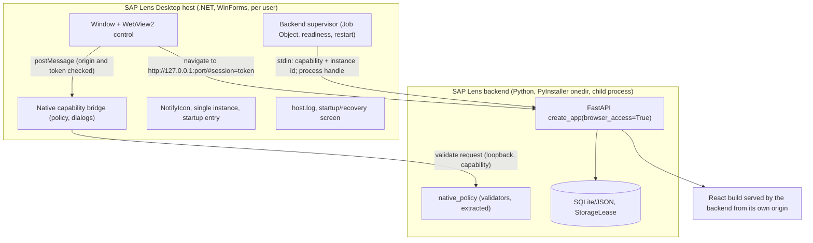
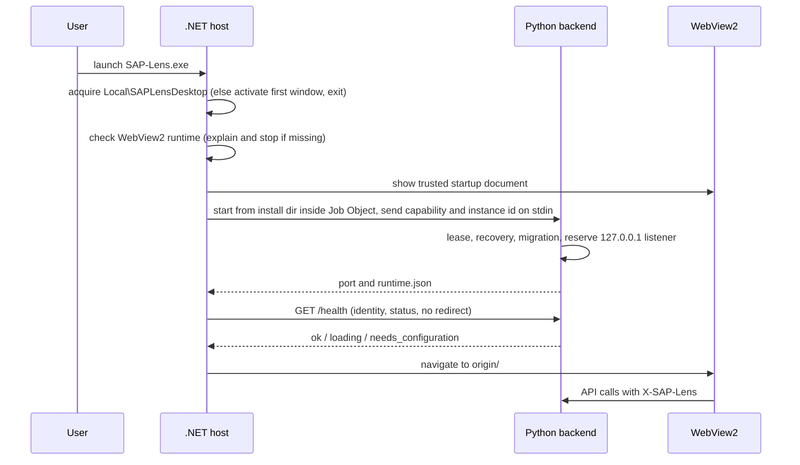
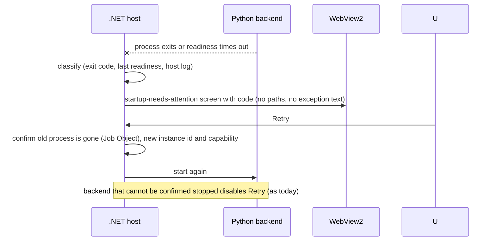

# Proposal: native .NET Desktop host with WebView2

Status: **proposal, not approved** (see [ADR 0001](decisions/0001-dotnet-desktop-host.md)). Nothing here is implemented. Facts about today's code are in
[Desktop host: current architecture](DESKTOP_HOST_CURRENT.md). Tags: **[V]** verified in the repository, **[A]** assumption to verify, **[P]** proposal.

## 1. Goal and non-goals

Replace the Python/pywebview window with a native Windows host that owns the window, WebView2, native dialogs, tray, single-instance and backend
supervision, **without** changing FastAPI business logic, the React frontend, SQLite persistence, the Windows Server distribution or any security
contract. The Python Desktop build stays supported until acceptance ends. Not goals: fixing the installer failure, signing, or AppLocker/WDAC policy
by changing language. None of those is solved by C# (current architecture, section 6).

## 2. Backend preservation analysis

| Concern | Today [V] | With a host process [P] |
|---|---|---|
| How the backend starts | `ManagedBackend` thread inside the Python window process | A **new headless desktop entry** in Python (for example `backend/desktop_backend.py`): same `create_app(browser_access=True, origin, session_token, instance_id)`, same lease, recovery and migration steps as `desktop.run()`, no `webview` import. `server.py` shows the pattern (it already runs the same app headlessly). |
| Arguments and environment | none; `config_dir()` from `SAP_LENS_CONFIG_DIR` or the default per-user directory | host passes only `--desktop` style flags and the config directory; no secrets on the command line or in the environment |
| Session capability | generated in `run()`, given to the page and to `NativeDialogs` | host generates it and hands it to the backend through **stdin** (closed after reading) or an inherited pipe; the backend never logs it; the page still receives it through the existing `#session=` fragment and `sessionStorage` handoff |
| Instance identity | `secrets.token_hex(16)`, compared by the readiness probe | same value, passed with the capability |
| Port | `reserve_listener`: 127.0.0.1, prefer 18743, else OS port, exclusive bind on Windows | backend reserves it (code reused as is) and **reports the port and `runtime.json`**; the host never connects to a port it did not see the owned backend report |
| Readiness | `/health` with identity check, no redirects | host repeats the same checks (app name, instance id, status set, size bound, no redirect) before navigating |
| Shutdown | daemon thread, `join(4)`, `force_exit`, listener close | host asks for graceful stop (stdin close or a loopback shutdown call carrying the capability), waits, then terminates; a **Windows Job Object with kill-on-close** guarantees no orphan if the host dies |
| SQLite locking and `StorageLease` | taken by the single process | taken by the backend process; the host never opens the database. The lease already refuses a second writer, so an old Python Desktop and the new backend cannot run on one data directory |
| Logging | one rotating log | backend keeps `sap-lens.log` and redaction; host writes `host.log` in the same directory with the same redaction rules and never logs the capability or URL fragments |
| Health | `/health`, `/health/live`, `/health/ready` | unchanged |

Python that must be **extracted or adapted** (not rewritten): (1) the startup, lease and migration sequence now inside `desktop.run()` into a function
both entries call; (2) the native-call validators now inside `_save_csv_dialog` and `_save_document_dialog` into a pywebview-free module; (3) the
tray preference logic in `DesktopBackground` is replaced by the host reading the same desktop settings. `main.py`, routers, stores and the frontend
need no change for Phase 2.

## 3. Host framework comparison

| Criterion | WPF + WebView2 | WinForms + WebView2 | Minimal host (one window, WebView2 control, no UI framework features) |
|---|---|---|---|
| Maintenance | richest, most code (XAML, MVVM habits) | small, stable, conventional | smallest; in practice this is WinForms with one form |
| Runtime needs | .NET Desktop runtime | .NET Desktop runtime | same |
| WebView2 integration | control hosts an HWND, so XAML overlays over it do not render ("airspace") | control is a plain child window, no overlay needs here | same as WinForms |
| Window lifecycle, single instance, tray | all manual; tray needs WinForms `NotifyIcon` or Win32 anyway | `NotifyIcon` built in; `FormClosing` and session-end handling are direct | same |
| Native dialogs | `Microsoft.Win32` dialogs | `OpenFileDialog`/`SaveFileDialog` | same |
| High DPI | good; per-monitor v2 via manifest | good since .NET 6/8 with `ApplicationHighDpiMode` | same |
| Accessibility | UI Automation, strong, but the page is the UI | host has almost no UI of its own; WebView2 exposes the page's UIA tree | same |
| Testability | view-model tests; UI tests heavy | logic in a library project is unit-testable; UI is a thin shell | best: all logic in a library, a few lines of UI |
| Build and packaging | same SDK-style project, more assets | same | same, fewest dependencies |
| Fit with this repo | no existing WPF code | the Service Manager is already C# WinForms (`deploy/windows/ServiceManager.cs`), so the team and review habits exist | as WinForms |

**Recommendation [P]: WinForms with a minimal shell** (a thin `Form` hosting one WebView2 control and one `NotifyIcon`), with all logic in a separate
class library: backend supervisor, native-capability policy, WebView2 policy, single-instance, diagnostics. WPF adds weight and the airspace
limitation for no gain because the page is the entire UI. This is not a separate fourth option: option 3 is the discipline applied to option 2.

**Target framework and OS baseline [A, verify before Phase 2].** Use the current .NET **LTS** at Phase 2 start; `net10.0-windows` is the likely choice,
but support dates must be read from Microsoft's .NET support policy at that time, because this environment has no .NET SDK (only Mono is installed) and
no network check was made. WebView2 Runtime support follows Microsoft's lifecycle for the Evergreen runtime; the repository's own floor is Windows
10 (`MinVersion=10.0` in the installer) and WebView2 86.0.622.0 (`windows_runtime.py`). Pin the WebView2 SDK NuGet package (`Microsoft.Web.WebView2`)
exactly and record it in the build manifest; it is the only new third-party dependency proposed.

## 4. Target architecture



Trust boundaries: (1) host to backend: child process started from the install directory by the host, secrets over a pipe, loopback HTTP with the
capability; (2) page to host: only messages from the exact backend origin, each carrying the capability; (3) host to disk: only after policy approval
and a user-chosen destination; (4) the backend never trusts the host's claim about file content or destination beyond its own validators.

### 4.1 Startup sequence [P]



### 4.2 Shutdown sequence [P]

```mermaid
sequenceDiagram
  participant H as .NET host
  participant B as Python backend
  H->>B: graceful stop (stdin closed / shutdown call with capability)
  B->>B: uvicorn should_exit, close listener, release lease, remove runtime.json
  alt exits within the bound
    B-->>H: exit code 0
  else timeout
    H->>B: terminate; Job Object kills any remainder
  end
  H->>H: release mutex, flush host.log, exit
```

### 4.3 Native file dialog [P]

```mermaid
sequenceDiagram
  participant P as React page
  participant H as .NET host
  participant B as Python backend
  participant D as OS dialog
  P->>H: postMessage {method: save_sod_csv, token, filename, content}
  H->>H: origin == backend origin? capability valid? one picker at a time?
  H->>B: POST /api/native/validate (loopback, capability): filename, header, size, format
  B-->>H: approved (fixed dialog title, filter) or rejected
  H->>D: SaveFileDialog (user chooses destination)
  D-->>H: absolute path
  H->>H: absolute, expected extension, not a link; atomic write
  H-->>P: true / false / error
```

### 4.4 Failure and recovery [P]



## 5. Security architecture

### 5.1 Does the threat model change?

Yes, in three bounded ways, and each needs an explicit control:

1. **A process boundary appears.** Today the capability never leaves one process. With a child backend it crosses a pipe and exists in two processes.
   Control: stdin handoff (not command line, not environment, not file), closed after the read; no logging; constant-time compare stays in Python.
2. **The page talks to a native host through WebView2 messaging** instead of pywebview's JS bridge. Control: accept messages only from the exact
   backend origin (`WebMessageReceivedEventArgs.Source`), require the capability in every call, reject unknown methods, one dialog at a time.
3. **The executable that starts the backend is chosen by the host.** Control: fixed path under the install directory, no PATH or working-directory
   lookup, hash against the package manifest before start, `SetDllDirectory`/safe search defaults in the host.

Everything that protects the loopback listener stays in Python and unchanged: exact Host, loopback peer, Origin allow-list, Sec-Fetch gate, token
check, exclusive bind.

### 5.2 Security migration checklist

| Control | Today (Python) | Required in .NET host | Regression test to add |
|---|---|---|---|
| Loopback only, IPv4/IPv6 | bind 127.0.0.1; peer 127.0.0.1 or ::1 | host connects to `127.0.0.1` only and refuses another origin; IPv6 loopback peer remains accepted by the backend | host unit: origin allow-list; backend: existing tests |
| Authenticated session | `X-SAP-Lens` capability, stale detection | host holds the capability only in memory | integration: wrong token gets 403 `stale_session` |
| WebView2 navigation | pywebview limited by `private_mode`, no downloads, no file URLs | `NavigationStarting` allows only the backend origin and the startup document; `NewWindowRequested` cancelled; `DownloadStarting` cancelled; `AreDevToolsEnabled=false`; `AreHostObjectsAllowed=false`; `IsWebMessageEnabled` only for the exact origin; no `file:` | native: navigate to another origin is blocked (also closes today's test gap) |
| Untrusted redirects | readiness opener fails on redirect | same in host HTTP client; `HttpClientHandler.AllowAutoRedirect=false`, no proxy | host unit |
| Native capability authorization | token in every `NativeDialogs` method | same check in the bridge before any dialog | host unit: unauthorized call gets no dialog |
| File and export permissions | Python validators; absolute, non-symlink, expected extension; `atomic_write` | dialog in C#, validators remain Python (validate endpoint), write checks repeated in C# | cross-language contract tests on the same fixtures |
| Process identity and ownership | in-process | Job Object kill-on-close; `runtime.json` instance id equals the one the host sent; host verifies pid | native: kill host, backend disappears |
| Executable substitution, DLL search | single EXE | absolute backend path under the install dir, manifest hash check, no search-path loading | native: tampered backend refused |
| Single instance | `Local\SAPLensDesktop` | same mutex name and window title or a stronger window handle contract | native: duplicate launch, old/new host exclusion |
| Config and secrets | files under `%LOCALAPPDATA%` | host stores nothing secret; any host config is non-secret | review |
| Temp files | none sensitive | none added | review |
| WebView2 user data | pywebview private mode | WebView2 user-data folder under the app data directory with an in-private profile **[A: confirm the exact API in the pinned SDK]**, deleted on exit | native: no cookies or cache survive restart |
| SQLite and backups | backend only | host never touches the database | n/a |
| Artifact integrity and identity | version resource, embedded identity, checksum, artifact-bound identity | multi-file manifest with per-file SHA-256, host and backend identities bound together | extend `test_windows_package.py`, add manifest tests |
| Log redaction | `AppLogFilter` | same rules in host log; never log the capability, URL fragment, or file content | host unit |
| Installer privileges | per user, no elevation | unchanged | `test_desktop_installer.py` |
| AppLocker and WDAC | one-file EXE unpacks to a temp directory at each start (a likely policy trigger) **[A: verify on a policy-enforced machine]** | a onedir layout executes from the install directory; policy rules then cover real paths; **signing is still required for strict policies** | native acceptance on a locked-down VM |

### 5.3 Frontend compatibility [P]

The frontend calls `window.pywebview.api.<method>(token, ...)` and listens for `pywebviewready`. The host injects (with
`AddScriptToExecuteOnDocumentCreated`, only effective for the backend origin) an object with the same 19 method names that posts a message and
resolves with the host's reply. The frontend is unchanged in Phase 2 and 3; renaming the contract later is a separate, optional change.

### 5.4 Where validation lives [P]

Option A: re-implement the validators in C#. Option B (recommended): the host calls a small loopback endpoint in the backend that validates a native
request and returns the approved fixed dialog parameters. B keeps one source of truth (the validators and their tests are already Python), at the cost
of one more authenticated endpoint. The endpoint must be reachable only with the capability, must not accept paths, and must not be exposed in server
mode. This is a design decision for Phase 3 (open question Q3).

## 6. Packaging and installer

Single-file does not mean single artifact. A single-file .NET host is one EXE for the host only; the Python backend, its libraries and the React build
are still separate files, so the product is a folder either way.

| Option | Host | Pros | Cons | Verdict |
|---|---|---|---|---|
| 1. Framework-dependent host + packaged Python | needs the .NET Desktop runtime installed | smallest download | one more prerequisite beside WebView2; runtime servicing outside our control; new failure mode on clean machines | defer |
| 2. Self-contained host + packaged Python | bundles the runtime (tens of MB) | no .NET prerequisite; the tested runtime ships | larger; we own runtime security updates | **recommended** |
| 3. Single-file host + external Python payload | one host EXE (may self-extract natives) | tidy host | extraction behaviour interacts with AppLocker; does not reduce file count | optional later, not first |

Backend packaging: keep **PyInstaller**, but build **onedir** for the Desktop backend (the Server bundle already does; `scripts/build_system/windows/server.py`),
because one-file unpacks to a temp directory on every start, which costs start time and is the most likely AppLocker/antivirus trigger. Nuitka
(native compile) is slower to build, needs a C toolchain and changes the debugging story; an embedded Python runtime (CPython embeddable zip plus
vendored site-packages) gives transparent files but moves dependency reproducibility and pip-audit coverage onto us. Neither is justified now; both
are deferred. Do not replace the packaging system in this migration.

Proposed layout (installed per user, as today):

```text
%LOCALAPPDATA%\Programs\SAP Lens\
  SAP-Lens.exe                 .NET host (self-contained)
  host\                        host assemblies and WebView2 loader
  backend\SAP-Lens-Backend.exe PyInstaller onedir backend and _internal\
  backend\frontend\dist\       React build (served by the backend)
  assets\                      icon
  manifest\package-manifest.json   per-file SHA-256, host and backend identity, version
  LICENSE*.txt, third-party notices
```

The installer (Inno Setup, same per-user model, same `AppMutex`, same isolated test AppId acceptance) installs the folder, keeps data and backups in
`%LOCALAPPDATA%` untouched on upgrade and uninstall, and keeps the WebView2 prerequisite check. The Windows Server ZIP, Service Manager and WinSW are
not touched.

## 7. Linux compatibility and build strategy

| Activity | Linux | Windows only |
|---|---|---|
| FastAPI backend, unit tests, pip-audit | yes (unchanged) | n/a |
| React build and browser tests | yes (unchanged) | n/a |
| Build the .NET host | **probably**: the SDK can target Windows from Linux with `EnableWindowsTargeting` **[A: verify in Phase 2; no SDK is installed here]** | WinForms and WebView2 execution |
| Run or test the host UI | no | yes |
| Pure C# library tests (supervisor logic, policy, manifest) | yes if kept free of Windows APIs behind interfaces | Job Object, mutex, tray, registry tests |
| PyInstaller Windows backend | no (PyInstaller does not cross-compile) | yes |
| Assemble the folder and write manifests | yes, given Windows binaries as inputs | verification of the PE files |
| Inno Setup compile | no (Windows tool) | yes |
| Authenticode signing | no with the standard tools | yes (see `CODE_SIGNING.md`) |
| Smoke, installer, SCM, AppLocker/WDAC acceptance | no | yes |

Strategy: keep the local-first rule (CI only on `main` after merge). Linux runs backend, frontend, C# library tests and manifest/layout checks;
a Windows machine runs `scripts\build.ps1`, PyInstaller, Inno Setup and every acceptance. A Linux result is never reported as Windows acceptance.

## 8. Unresolved questions

See [ADR 0001](decisions/0001-dotnet-desktop-host.md#open-questions).
