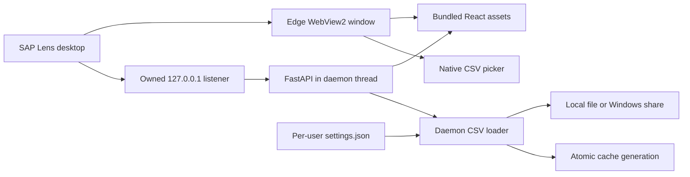

# Architecture and performance

The desktop launcher first acquires the per-session Windows named mutex. Secondary launches activate the existing window without probing a socket. It then reserves a loopback listener, preferring `18743` and falling back to an OS-assigned port if needed. It opens a trusted branded startup document, starts an in-process Uvicorn daemon thread against that socket, and verifies API readiness/instance identity before navigating the existing WebView2 window to the application. Closing the window owns service shutdown; no detached service subprocess can survive the EXE.

`create_app` receives the actual selected origin, a random per-launch capability and an instance identity. Desktop CORS permits exactly that origin; both API reads and writes require the capability. The capability is bootstrapped via a fragment, removed from the URL and kept in the private window's session storage to support reload. Only non-secret instance diagnostics are written to `runtime.json`. The native bridge exposes capability-guarded CSV/logo pickers, configuration export and opening the fixed configuration directory. A watchdog closes the window and reports failure if its owned backend exits unexpectedly.

Initial CSV loading is asynchronous and does not block API/window startup. A daemon loader thread builds a new cache; canceled loads check cancellation before publication/settings writes. ApplicationDataProvider observes configuration above routes, polls during and after loading,
and invalidates dataset queries when the published revision changes. A slow filesystem can still delay a load, but cannot keep Python alive after app shutdown. Mutations use the same daemon-load helper rather than asyncio's non-daemon default executor. One active load is accepted at a time. Cancel invalidates its publication generation and permits a replacement, with at most two living daemon CSV workers. Preview work has two separate bounded daemon slots.

## Cache and bundle improvements

The standard-library CSV reader replaces pandas/dataframes. Validated canonical observations are retained within bounded source generations so user assignments can be remapped against a refreshed catalogue without reopening a failed user source. Pandas/numpy are no longer runtime dependencies. Each complete cache generation contains details, precomputed summaries/counts, module labels and a reverse T-code index. Readers retain one snapshot per request, so a refresh cannot mix generations or leave the T-code index stale. File-location persistence happens only after CSV validation and before publication. Failures retain the previous data/settings.

Comparison work is bounded to two to five roles. Prefix T-code search still scans index keys; memory still scales with the complete role graph, including overlap assignments. CSV input/row/identifier and field limits bound parsing work, but the complete graph still consumes memory. See [CSV schemas](../data/CSV_SCHEMAS.md) for exact semantics.

The frontend uses same-origin native fetch instead of Axios, no Google Fonts and no offline service worker. The production frontend contains the investigation pages and settings/picker UI; use the current production-build output for bundle sizes. Browser test dependencies stay in development tooling and do not enter the frontend bundle. React Query retains role data in memory; material analysis changes reset lists, details, comparisons and role selection. Organization/theme changes do not rebuild the CSV. The list renders 100 cards per page; counts are computed in one pass.

## Development and verification

Vite uses `127.0.0.1:18743` and proxies API requests to a backend at `18744`. Production uses FastAPI-served assets on the owned desktop origin. The source-mode API remains available for development with the custom mutation header and explicit loopback CORS. Desktop capabilities are supplied by the launcher, not a production environment variable.

Regression tests run the actual HTTP server/lifecycle with mocked native boundaries, including repeated launch/close and an unrelated occupied port. Playwright tests load the production assets with session enforcement, stub only the picker bridge and verify reload, errors, configuration and absence of external requests. The Windows workflow separately builds and launches the packaged EXE. The real picker, WebView2 UI, OS mutex/focus behavior and clean-PC prerequisites still require Windows validation.

## Configuration and provenance

Pydantic schema-versioned settings separate organization metadata, import mappings, area appearance and two source-specific import format collections. Revision checks prevent stale overwrites; backups and atomic writes preserve recovery. The central registry is served through the API. Cache generations preserve raw relationship identifiers, source-area hints, alternate descriptions and transaction provenance independently of SAP area labels. Import-format versions and configuration revisions make generations traceable. Custom logos are private sanitized PNG assets, never packaging inputs.

A synthetic 10,000-row / 1,000-root load took 6.47 seconds with 21.66 MiB peak Python-traced allocations while tracemalloc was enabled in this Linux workspace. This is one diagnostic observation, not an end-user speed guarantee or a measured improvement over the earlier implementation.

## Desktop UX 1.2

The WebView starts with a trusted in-memory branded document before starting the API in its callback worker. Readiness verifies the owned instance over the prebound listener before navigation. Closing invalidates startup waits. The React configuration gate and actual loader status handle the remaining startup states and recovery. Settings is an in-app workspace that preserves the mounted dashboard. Central palette tokens derive appearance, independent of SAP area colors. Theme and diagnostics behavior is documented in [Appearance](APPEARANCE.md).

## Maintained entry points

Desktop production uses `backend/desktop.py`, packaged by `scripts/build-windows.ps1` and the manual Windows workflow. Developer desktop execution uses the same module with pythonw, never an independent backend launcher. Browser development intentionally uses `npm run dev` (Vite plus reloadable Uvicorn); it remains an active development tool, not a supported end-user launch path. The browser fixture server is isolated test infrastructure. Backend `/api/settings` compatibility routes remain because tests and packaged smoke tooling still use them.

## User access investigation

The atomic cache also contains a separately parsed user export, a reusable literal-prefix catalogue matcher and reverse assignment evidence. User Access and Release Roles consume this generation without a third CSV or external connection. Classification rules and domain configuration are retired. See [User Access](../features/USER_ACCESS.md) for the schema, migration boundary, status semantics and strict PR/PO parser.

## Optional identity enrichment

`employee_directory.py` owns bounded, immutable-in-use directory snapshots, exact email matching and non-recursive manager resolution. `routers/employees.py` exposes session-protected preview, digest/revision-checked replacement, search and enrichment. The existing settings schema adds disabled-by-default feature state and a local source path; existing SAP snapshots and import presets remain independent. Directory record links carry a generation digest. Slow startup filesystem reads do not hold the publication lock, and clear/import invalidates in-flight reads. See [Employee Directory](../data/EMPLOYEE_DIRECTORY.md) for data and health contracts.

## CSV lifecycle and private refresh evidence

`csv_lifecycle.py` stages immutable canonical observations and commits their references, bounded history metadata and feature/source settings in one atomic configuration write. It publishes one coherent cache generation after independent source results are prepared. `employee_preview.py` filters raw preview rows off the event loop and renders only the selected page; replacement summaries and identity coverage are cached against immutable dataset identities. History listings read compact metadata, not full record reports. See [CSV data lifecycle](../data/IMPORT_AND_REFRESH.md) for modes, recovery, identities and consistency guarantees.

## Headless server deployment

`backend/server.py` hosts the same FastAPI factory and production frontend without
WebView2. Hosting policy is centralized in `backend/deployment.py`; server data
uses a separate directory and a process-held lease. Browser uploads stage inputs
for the existing CSV validation/confirmation lifecycle. Desktop startup and its
release pipeline remain independent. See [deployment modes and operations](../deployment/README.md)
and [access-boundary assumptions](../deployment/SECURITY.md).
