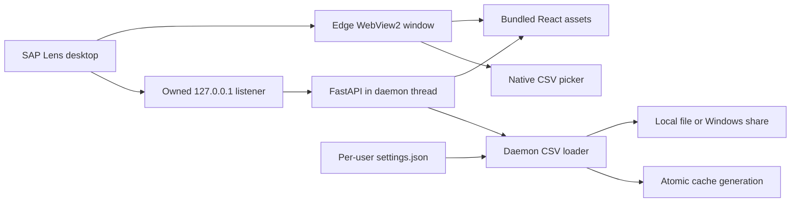

# Architecture and performance

The desktop launcher first acquires the per-session Windows named mutex. Secondary launches activate the existing window without probing a socket. It then reserves a loopback listener, preferring `18743` and falling back to an OS-assigned port if needed. It opens a trusted branded startup document, starts an in-process Uvicorn daemon thread against that socket, and verifies API readiness/instance identity before navigating the existing WebView2 window to the application. Closing the window owns service shutdown; no detached service subprocess can survive the EXE.

`create_app` receives the actual selected origin, a random per-launch capability and an instance identity. Desktop CORS permits only the selected port's explicit 127.0.0.1 and localhost origins; both API reads and writes require the capability. WebView2 bootstraps via a fragment, removed into session storage. A plain browser on the same PC can acquire the same capability only through the guarded root-document navigation handoff described in [Desktop](DESKTOP.md); it uses the existing backend and state, not another process. Only non-secret instance diagnostics are written to `runtime.json`. The native bridge exposes capability-guarded CSV/logo pickers, configuration export and opening the fixed configuration directory. A watchdog closes the window and reports failure if its owned backend exits unexpectedly.

Initial CSV loading is asynchronous and does not block API/window startup. A daemon loader thread builds a new cache; canceled loads check cancellation before publication/settings writes. ApplicationDataProvider observes configuration above routes, polls during and after loading,
and invalidates dataset queries when the published revision changes. A slow filesystem can still delay a load, but cannot keep Python alive after app shutdown. Mutations use the same daemon-load helper rather than asyncio's non-daemon default executor. One active load is accepted at a time. Cancel invalidates its publication generation and permits a replacement, with at most two living daemon CSV workers. Preview work has two separate bounded daemon slots.

## Cache and bundle improvements

The standard-library CSV reader replaces pandas/dataframes. Validated canonical observations are retained within bounded source generations so user assignments can be remapped against a refreshed catalogue without reopening a failed user source. Pandas/numpy are no longer runtime dependencies. Each complete cache generation contains details, precomputed summaries/counts, module labels and a reverse T-code index. Readers retain one snapshot per request, so a refresh cannot mix generations or leave the T-code index stale. File-location persistence happens only after CSV validation and before publication. Failures retain the previous data/settings.

Comparison work is bounded to two to five roles. Prefix T-code search still scans index keys; memory still scales with the complete role graph, including overlap assignments. CSV input/row/identifier and field limits bound parsing work, but the complete graph still consumes memory. See [CSV schemas](../data/CSV_SCHEMAS.md) for exact semantics.

The frontend uses same-origin native fetch instead of Axios, no Google Fonts and no offline service worker. The production frontend contains the investigation pages and settings/picker UI; use the current production-build output for bundle sizes. Browser test dependencies stay in development tooling and do not enter the frontend bundle. React Query retains role data in memory; material analysis changes reset lists, details, comparisons and role selection. Organization/theme changes do not rebuild the CSV. The list renders 100 cards per page; counts are computed in one pass.

## Development and verification

Vite uses `127.0.0.1:18743` and proxies API requests to a backend at `18744`. Production uses FastAPI-served assets on the owned desktop origin. The source-mode API remains available for development with the custom mutation header and explicit loopback CORS. Desktop capabilities are supplied by the launcher, not a production environment variable.

Regression tests run the actual HTTP server/lifecycle with mocked native boundaries, including repeated launch/close and an unrelated occupied port. Playwright tests load the production assets with session enforcement, stub only the picker bridge and verify reload, errors, configuration and absence of external requests. The Windows workflow separately builds and launches the packaged EXE. The real picker, WebView2 UI, OS mutex/focus behavior and clean-PC prerequisites still require Windows validation.

## Configuration and provenance

Pydantic schema-versioned settings separate organization metadata, import mappings, area appearance and two source-specific import format collections. Revision checks prevent stale overwrites; backups and atomic writes preserve recovery. The central registry is served through the API. Cache generations preserve raw relationship identifiers, source-area hints, alternate descriptions and transaction provenance independently of SAP area labels. Import-format versions and configuration revisions make generations traceable. Custom logos are private sanitized PNG assets, never packaging inputs.

A synthetic 10,000-row / 1,000-root load took 6.47 seconds with 21.66 MiB peak Python-traced allocations while tracemalloc was enabled in this Linux workspace. This is one diagnostic observation, not an end-user speed guarantee or a measured improvement over the earlier implementation.

## Desktop UX 1.2

The WebView starts with a trusted in-memory branded document before starting the API in its callback worker. Readiness verifies the owned instance over the prebound listener before navigation. Closing invalidates startup waits. The React configuration gate and actual loader status handle the remaining startup states and recovery. Settings is an in-app workspace that preserves the mounted dashboard. Central palette tokens derive appearance, independent of SAP area colors. Theme and diagnostics behavior is documented in [Appearance](APPEARANCE.md).

## Maintained entry points

Desktop production uses `backend/desktop.py`, packaged by `scripts/build-windows.ps1` and the manual Windows workflow. Developer desktop execution uses the same module with pythonw, never an independent backend launcher. Browser development intentionally uses `npm run dev` (Vite plus reloadable Uvicorn); it remains an active development tool, not a supported end-user launch path. The browser fixture server is isolated test infrastructure. Backend `/api/settings` compatibility routes remain because tests and packaged smoke tooling still use them.

## User access investigation

The atomic cache also contains a separately parsed user export, a reusable literal-prefix catalogue matcher and reverse assignment evidence. User Access and Release Roles consume this generation without a third CSV or external connection. Classification rules and domain configuration are retired. See [User Access](../features/USER_ACCESS.md) for the schema, migration boundary, status semantics and strict PR/PO parser.

## Optional identity enrichment

`employee_directory.py` owns bounded, immutable-in-use directory snapshots, exact email matching and non-recursive manager resolution. `routers/employees.py` exposes session-protected preview, digest/revision-checked replacement, search and enrichment. The existing settings schema adds disabled-by-default feature state and a local source path; existing SAP snapshots and import presets remain independent. Directory record links carry a generation digest. Slow startup filesystem reads do not hold the publication lock, and clear/import invalidates in-flight reads. See [Employee Directory](../data/EMPLOYEE_DIRECTORY.md) for data and health contracts.

## CSV lifecycle and private refresh evidence

`csv_lifecycle.py` stages immutable canonical observations and commits their references, bounded history metadata and feature/source settings in one atomic configuration write. It publishes one coherent cache generation after independent source results are prepared. `employee_preview.py` filters raw preview rows off the event loop and renders only the selected page; replacement summaries and identity coverage are cached against immutable dataset identities. History listings read compact metadata, not full record reports. See [CSV data lifecycle](../data/IMPORT_AND_REFRESH.md) for modes, recovery, identities and consistency guarantees.

## Headless server deployment

`backend/server.py` hosts the same FastAPI factory and production frontend without
WebView2. Hosting policy is centralized in `backend/deployment.py`; server data
uses a separate directory and a process-held lease. Browser uploads stage inputs
for the existing CSV validation/confirmation lifecycle. Desktop startup and its
release pipeline remain independent. See [deployment modes and operations](../deployment/README.md)
and [access-boundary assumptions](../deployment/SECURITY.md).

## SQLite store: source revisions and derived state

One database, `<data dir>/store/sap-lens.sqlite3`, is the only SQLite file (`backend/store_db.py`: connection, schema ladder, permissions, signing key). It is a **rebuildable,
optional** structure. The validated JSON stores and the immutable, content-addressed snapshots under `csv-data/snapshots` remain the authority and the format older versions read;
review decisions, periods, frozen evidence and settings never move. If the database is missing, damaged or from a newer version, SAP Lens reads the snapshots exactly as before.

| Table | Content | Authority |
| --- | --- | --- |
| `source_revisions`, `rows_roles`, `rows_users`, `rows_sod` | Typed (one column per field) copy of the records of a snapshot. A revision is keyed by the snapshot digest, carries a row count and a rows digest, and has a `sequence`. | Derived from the snapshot; `source_store.reconcile` makes it follow the committed configuration, never the other way round. |
| `derived` | Authenticated serialized model (catalogue, users, assignment indexes) keyed by snapshot digest, settings that shape the derivation, catalogue digest and code digest. Lists the revisions it depends on. | Rebuildable. |
| `migrations`, `meta` | Upgrade records and schema facts. | Mirror of `.application-backups/migration/<id>/record.json`. |

- **Revisions and atomic replacement.** Per (source, scope) exactly one revision is `active`; a partial unique index makes the database itself reject a second one. Replacing a source is
  one transaction: insert the new rows, flip the old revision to `superseded`, activate the new one. Readers see the old or the new revision, never a mixture. The latest two superseded
  revisions are kept (previous approved revision for comparison and rollback); pruning a revision deletes its rows and exactly the derived values that list it. The import workflow itself is
  unchanged in this step; the next phase writes revisions as part of the import transaction.
- **One representation of the raw records.** A derived entry does not contain the raw records; on a hit they are re-attached from the revision. The first derived cache (a separate
  `cache/derived.sqlite3` with whole-state pickles keyed by file hash) was folded into this store and is removed on upgrade.
- **Integrity.** Revision rows are verified against the recorded row count and digest on every read; a mismatch discards the revision and falls back to the snapshot. Derived entries carry an HMAC
  (`store/.key`, owner-only, 32 random bytes) that is verified *before* deserialization, and deserialization is additionally restricted to data containers and this application's own model
  classes, so even a validly signed payload cannot name `os`, `subprocess` or `builtins.eval`. The directory is created `0700` and the database `0600` (WAL files inherit it) on POSIX;
  on Windows the data directory's private ACL applies.
- **Concurrency.** WAL, `busy_timeout` 15 s, one short-lived connection per operation (never shared between threads), `BEGIN IMMEDIATE` for every write, a process-wide lock around the
  connection lifecycle. The storage lease keeps one application process per data directory (desktop and server alike); additional processes (maintenance CLI, tests) are safe because SQLite
  serializes writers and WAL lets readers proceed.
- **Schema versions.** `PRAGMA user_version` plus an ordered ladder of idempotent steps, each in its own transaction. A database written by a newer version is neither opened for writing nor
  modified or deleted; SAP Lens runs from the snapshots.

### Upgrade of an existing installation

`backend/storage_migration.py` runs at startup under the storage lease (desktop and server), before requests are served, and never blocks startup.

1. Detect: no `store/` and an installation with settings or `csv-data` present, otherwise a fresh install (empty store, no backup).
2. **Verified backup first**, with the same archive engine as manual backups (`maintenance.backup` + `verify`, SHA-256 per file and for the archive), stored at
   `.application-backups/migration/<id>/pre-migration.tar.gz` with a JSON `record.json`. If it cannot be created and verified (space, permissions), the migration does not run and is retried at the next start.
3. Mirror every active snapshot into the store and prove each revision reads back with a valid digest. Any failure leaves the record `migrating`; the next start resumes with the same backup.
4. **Retention until confirmed.** The archive is kept until an administrator confirms in *Settings > Backup & Restore* (or `POST /api/storage/migration/confirm`). Confirmation re-checks the store and then releases
   the archive. Nothing deletes it by age; scheduled-backup retention only manages numbered operation folders.
5. Recovery: a damaged database is moved aside as `sap-lens.sqlite3.corrupt-<time>` and rebuilt from the snapshots; the pre-migration archive restores the previous installation byte-for-byte
   with the existing `maintenance.py restore` (tested). Because the JSON stores are never modified, an older SAP Lens can also be started on the upgraded directory.

### How SQLite and the JSON stores stay consistent

Every authoritative record has exactly one home; SQLite holds derived, verifiable copies.

| Event | Authoritative (JSON / snapshots) | SQLite store |
| --- | --- | --- |
| Import | Validated records are staged as an immutable snapshot; one compare-and-swap save of `settings.json` activates the new revision (or nothing changes). | After the commit, `reconcile` ingests that snapshot as the active revision (one transaction). A failure only means the snapshot is read next time. |
| Held (suspicious) import | Nothing is written; the active revision stays. | Unaffected. |
| Migration / upgrade | No conversion of review decisions, periods or evidence; formats unchanged. | Built from the snapshots after a verified backup; resumable; see above. |
| Backup | Archived with the snapshots, as before. Automatic backups expire after 90 days, manual and migration backups are protected ([backup retention](../deployment/BACKUP_RESTORE.md#backup-retention-three-classes)). | Excluded (`store/`, `cache/`), so an archive never carries a second copy of source data. |
| Restore | The archive replaces the JSON stores atomically. | The destination's store is kept; it is reconciled to the restored configuration at the next start (new snapshot digests are ingested, a damaged store is rebuilt). |
| Cleanup / retention | Two categories, daily check, one-time approval each (see [Data retention](../data/IMPORT_AND_REFRESH.md#data-retention)). Source: superseded, unreferenced snapshots aged from the logical *superseded* moment. Review: completed review periods aged from their completion timestamp, with journalled, recoverable removal; shared evidence, the report log and anything referenced stay. No cross-store atomicity is claimed. | Derived entries and revisions of a retired snapshot are removed first; orphans are removed on every run; superseded revisions beyond the kept two are pruned as before. |
| Concurrent server use | Existing locks and revision checks serialize writers. | WAL, short immediate transactions, busy timeout; reads never block on writers. |

### Measured effect (synthetic corpus, this container, Python 3.12)

Reproduce with `python scripts/benchmarks/data_benchmark.py` ([Testing](../development/TESTING.md#data-path-benchmark)). 192 000 assignment rows (17 MB of CSV), real production path
(`csv_lifecycle.load`), each scenario in a fresh process. "Before" is the unmodified code (original), "Step 1" the SQLite store release, "Step 2" source-specific refresh.

| Scenario | Original | Step 1 | Step 2 |
| --- | --- | --- | --- |
| Import (parse, derive, stage, activate) | 20.2 s, peak 1017 MB | 21.3 s, peak 1028 MB | 16.4 s, peak 836 MB |
| Start, Dynamic sources, unchanged files (first after an import / next starts) | 27.8 s, peak 1164 MB | 28.1 s / 21.8 s, peak 1215 MB | 6.7 s / 2.2 s, peak 655 / 525 MB |
| Refresh, one source changed (users) | not measured | 24.6 s, peak 1251 MB | 15.3 s, peak 1125 MB |
| Start, Static sources | 9.8 s, peak 730 MB | 6.2 s first / 2.2 s next | 6.5 s first / 2.1 s next, peak 525 MB |
| Disk after import | snapshots 132 MB | snapshots 132 MB + store 28 MB (rows) | unchanged |

The first start after an import still derives the model once (about 4 s) and stores it; later starts load it. Resident memory of a started instance is about 525 MB, of which about 185 MB are the raw
source records retained for comparisons; removing that retention needs comparisons against the store and is a separate refactor.

### Request and refresh performance (192 000 assignment rows, 16 000 SAP users, this container)

Profiling first (`--api --profile api`): the users list and the Dashboard spent 70 % of their time re-parsing the same few date strings for every assignment on every request, and the users list recomputed export totals across all users each time. Changes, all behaviour-preserving:

| Change | Why it is safe |
| --- | --- |
| `sap_date` memoized (`lru_cache`) | Pure function of its text; errors are raised again every call, never cached |
| Dataset-level assignment status counts (Dashboard) and per-user expired counts (users list), memoized per dataset and day | Held on the SAP dataset object, so a refresh or a new day recomputes; excluded from pickling and copying |
| `diff_records`: exact records cancel first across the whole source, only the remainder is grouped by identifier; records are identified by a tuple of references instead of per-row JSON text | Randomised differential test against the former implementation (counts, ambiguity, missing identifiers, every change) |
| Snapshots are streamed to a temporary file while hashing instead of building the full text and its bytes | Byte-identical output, so every existing snapshot keeps its identity; the test compares against the former encoding |

| Measurement (median of 5 requests unless noted) | Before | After |
| --- | --- | --- |
| `GET /api/access/users?limit=50` | 631 ms | 203 ms |
| same, sorted | 686 ms | 189 ms |
| `GET /api/dashboard` | 734 ms | 151 ms |
| Refresh, users source changed (time / peak memory) | 15.3 s / 1164 MB | 11.2 s / 1071 MB |

What remains: both endpoints still scan every user once per request (selection and summaries, about 0.24 s and 0.17 s of the users page); caching those would need invalidation keyed to the filters and is not done. Peak memory of a changed-source refresh is dominated by the
old dataset (kept until publication) plus the new one (about 350 MB for 192 000 records); the retained raw source records (about 185 MB per running instance) are unchanged.
