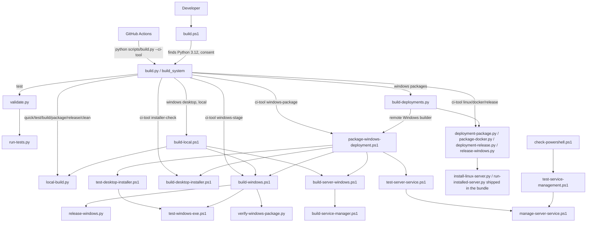

# Repository audit

Permanent record of the repository audit and cleanup of November 2026 (branch `work`, audited at `17852bc`). Findings and decisions are listed
first; the outcome of each change is recorded in the *Outcome* section as the cleanup phases complete. Day-to-day status lives in
[PROGRESS.md](PROGRESS.md).

## Method

Tracked files (`git ls-files`, 655 at the start), ignored files (`git status --ignored`), references between files (every script, document and
asset searched across workflows, scripts, tests, documentation and packaging), dependency declarations against imports, a pattern scan for
credentials (paths only; no values are reproduced), and the local validation entrypoints.

Classification: **Remove** (safe to remove), **Consolidate**, **Migrate**, **Verify** (needs verification, kept for now), **Preserve**.

## Structure at the start

| Area | Tracked files | Notes |
| --- | --- | --- |
| `frontend/` | 311 | React 18, Vite, Tailwind; Playwright specs in `tests/` |
| `backend/` | 200 | FastAPI application, 120+ unittest modules in `tests/` |
| `scripts/` | 59 | build engine, packaging, verification, validation, benchmarks |
| `docs/` | 55 | architecture, data, deployment, development, features, getting-started, validation |
| `deploy/`, `examples/`, `.github/`, `assets/` | 7, 6, 4, 2 | service files, synthetic examples, four workflows, logo and icon |
| root | 9 | `README.md`, `AGENTS.md`, `CLAUDE.md`, `LICENSE.md`, `build.ps1`, `Dockerfile`, `compose.yml`, `ruff.toml`, ignore and attribute files |

No generated artifacts, caches, logs, databases, archives or binaries beyond the two logo images, two favicons and the validation workbook are tracked.
Ignored local directories (`build/`, `backend/build/`, `frontend/dist/`, `frontend/test-results/`, caches) are correctly covered by `.gitignore`.

## Findings

### Medium

| # | Finding | Evidence | Class | Action |
| --- | --- | --- | --- | --- |
| M1 | `npm run lint` fails: 115 warnings against a ceiling of 111 (`--max-warnings 111`). The gate was already red at the original baseline `5a943c3` (115 warnings and one error; the error was fixed in Phase E). Fast Validation on `main` runs this check. | `frontend/package.json`, lint run | Migrate | Set the ceiling to the measured 115 and document it as a ratchet that may only go down. Warnings are existing `any`/hooks warnings in older code and specs; no rule is relaxed. |

### Low

| # | Finding | Evidence | Class | Action |
| --- | --- | --- | --- | --- |
| L1 | Policy text on CI is duplicated between `docs/development/CI.md` and `docs/deployment/CI_CD.md`; `CI_CD.md` also keeps a dated section "Package stabilization - 1 November 2026". | both files | Consolidate | One owner for the policy (`development/CI.md`), `CI_CD.md` keeps the pipeline levels and links to it; dated log content moves to Git history. |
| L2 | Version-stamped headings ("Windows Desktop 1.2", "(1.2)", "Desktop UX 1.2") in permanent architecture documents. | `architecture/DESKTOP.md`, `APPEARANCE.md`, `API.md`, `SYSTEM.md` | Consolidate | Retitle without version stamps; content stays. |
| L3 | Dated audit heading and old pass counts presented as facts ("Script inventory (audit of 2026-11-04)", "84 passed", "30 passed in 6.5 minutes"). | `BUILD.md`, `development/DEPENDENCY_MAINTENANCE.md`, `TESTING.md` | Consolidate | Drop the date from the heading; mark measurements as dated records or remove the counts. |
| L4 | No single architecture document for storage, source revisions, caching, the revision token and review integrity; the content is spread over `SYSTEM.md`, `data/IMPORT_AND_REFRESH.md`, `deployment/BACKUP_RESTORE.md`, `TESTING.md` and `PROGRESS.md`. | `grep` of the topics | Migrate | New `architecture/STORAGE_AND_REVISIONS.md`; other documents link to it instead of repeating. |
| L5 | Retention (source, review, backup), backup classification, approvals, the count limit versus the age maximum, and review-cleanup undo are documented in three places and not in one operational guide. | `IMPORT_AND_REFRESH.md`, `BACKUP_RESTORE.md`, `EMPLOYEE_DIRECTORY.md` | Migrate | New `operations/DATA_RETENTION.md`; the existing documents keep a short pointer. |
| L6 | `DEVELOPMENT.md` repeats the Windows toolchain prerequisites that `BUILD.md` owns. | both files | Consolidate | Keep one prerequisite matrix (`BUILD.md`) and link from `DEVELOPMENT.md`. |
| L7 | `docs/deployment/CI_CD.md` recommends Dependabot for the SHA-pinned actions; no `.github/dependabot.yml` exists. | `CI_CD.md` | Preserve | Stays a documented recommendation; adding it is a policy decision, not cleanup. |
| L8 | `test-service-management.ps1` is parse-checked but executed by no build step (already recorded debt). | `BUILD.md` | Preserve | Needs a Windows host to wire in. |

### Informational

* **No removable script.** All 54 scripts were searched again: each is referenced by documentation, a test, another script or a workflow
  (`generate-examples.py`, `profile-sod.py`, `validate.sh/.ps1` and the manual native smoke tests only by documentation, which is their
  documented role). Public entrypoints (`build.ps1`, `scripts/build.py`, `scripts/validate.*`, `scripts/run-tests.py`) are preserved. *Preserve all.*
* **Dependencies.** Every backend runtime requirement has an importer or an explicit packaging role (`tzdata` for Windows time zones,
  `python-multipart` for uploads). Frontend: all runtime dependencies are imported. `postcss`, `autoprefixer`, `@types/react-dom` and
  `@types/node` are consumed by configuration or type resolution rather than imports. *Verify and keep*; removal would need a type-check and build
  proof, with no gain. No broad upgrades were made. `npm audit --omit=dev` reports 0 vulnerabilities.
* **Security hygiene.** No credentials, keys, certificates, databases or logs are tracked. The credential-pattern scan matches only synthetic
  session tokens and passwords in test fixtures. `backend/.env.example` and `deploy/server.env.example` contain placeholders only. No hard-coded
  user paths outside an example comment. *Preserve.*
* **Links.** `scripts/check-docs.py` reports no broken relative link; a separate scan of path mentions found only generated build outputs,
  test fixtures and the Dependabot recommendation above.
* **CI triggers.** `validate.yml` triggers on push to `main` only; the other three workflows are `workflow_dispatch` only; `check-workflows.py` enforces this.
* **File modes.** Only `scripts/validate.sh` and `deploy/docker/manage.sh` are executable, which matches their use; everything else is run through an interpreter.
* **Assets.** Both logo files, both favicons and the icon are referenced (README, desktop launcher, packaging, `index.html`).

## Documentation inventory

| Path | Purpose / audience | Decision |
| --- | --- | --- |
| `README.md`, `AGENTS.md`, `CLAUDE.md`, `LICENSE.md` | entrypoint, agent rules, license | Keep; README gains the navigation and validation status |
| `docs/README.md` and the section `README.md` files | index | Keep; add the new documents |
| `docs/getting-started/*` | install, configure, troubleshoot | Keep; check commands |
| `docs/features/*` (12) | functional guides | Keep; Account Review and SoD get a link to the integrity architecture |
| `docs/data/*` (8) | schemas, import and refresh, directory | Keep; pointers to retention and storage |
| `docs/architecture/*` (11) | design, API, security | Retitle (L2); add `STORAGE_AND_REVISIONS.md` |
| `docs/deployment/*` (10) | targets, security, backup, CI/CD, releases | Keep; trim `CI_CD.md` (L1) |
| `docs/development/*` (6) | source setup, tests, CI, progress | Merge overlap (L1, L6); add this audit |
| `docs/operations/` (new) | retention and recovery for administrators | Add `README.md` and `DATA_RETENTION.md` (L5) |
| `docs/BUILD.md` | build system reference | Keep at its documented path (19 references, printed by tools) |
| `docs/validation/*` | tracker CSV, workbook, workflow matrix | Keep (generated by `scripts/validation_tracker.py`) |

A `reference/` directory is not created: configuration lives in `getting-started/CONFIGURATION.md`, CSV schemas in `data/CSV_SCHEMAS.md`, the API in
`architecture/API.md`, and splitting them would add links without removing duplication.

## Outcome

### Phase 2: scripts and entrypoints

* `build.ps1` moved from the repository root to `scripts/build.ps1`. Repository root and `build.py` are resolved from `$PSScriptRoot`, the `.venv` lookup is inside the discovery function so the test harness that loads the function definitions still works, help text and the install hint use the new path. No duplicate at the root.
* Moved with all references updated: `generate-examples.py`, `reference-template.py`, `validation_tracker.py` to `scripts/maintenance/`; `profile-sod.py` to `scripts/benchmarks/`.
* Added `scripts/README.md` (what to run, internal helpers, platforms); `docs/BUILD.md` inventory updated.
* M1 resolved: the lint warning ceiling is 115 (measured), a ratchet that may only go down.
* Not moved, deliberately: the deployment builders, Linux bundle runtime scripts and Windows packaging scripts. They are addressed by path from workflows, release tooling and shipped bundles; the PowerShell ones cannot be executed or re-verified here.
* Validation: unified-build, local-build, workflow, repository, test-profile, validation-tracker and SoD-reference tests pass; `build.py` runs from another working directory (dry run exit 0, invalid arguments exit 2). PowerShell execution of `scripts/build.ps1` is not verified (no PowerShell host).

### Phases 3 to 5: build audit and documentation

* **Build and workflow audit (no change needed).** Workflows and Docker files reference only existing paths; the PowerShell scripts fail fast and check native exit codes through
  helpers (`Assert-Success`, `Checked`, `$LASTEXITCODE`); triggers are unchanged (`push` to `main` only for validation); `build.py` returns 0 for a dry run and 2 for invalid arguments
  from any working directory. Documented build commands match the script parameters. PowerShell could not be executed here.
* **Moved.** `IMPORT_AND_REFRESH.md#data-retention` content to `operations/DATA_RETENTION.md`; the SQLite, upgrade and consistency sections and the measurements of `architecture/SYSTEM.md` to
  `architecture/STORAGE_AND_REVISIONS.md` and `development/PERFORMANCE.md`.
* **New.** `architecture/STORAGE_AND_REVISIONS.md` (adds Static and Dynamic mode, fingerprints, staged activation, lifecycle memory, revision token, review integrity),
  `operations/README.md`, `operations/DATA_RETENTION.md` (adds backup classes and count limit versus age limit), `development/PERFORMANCE.md`, `scripts/README.md`.
* **Consolidated.** Backup count/age explanation lives in `DATA_RETENTION.md`; `BACKUP_RESTORE.md` links to it. Version stamps removed from four headings. The dated "Package stabilization"
  log was removed from `CI_CD.md` (it is in Git history). `DEVELOPMENT.md` and `BUILD.md` were found complementary (installation walkthrough versus prerequisite matrix) and are cross-linked, not merged.
* **README.** Gained "How it works" and "Security and operations"; the logo block and navigation links are unchanged.

### Phase 6: dependencies, configuration and security hygiene

No change was needed beyond the lint ceiling. Backend requirements: every runtime package has an importer or a packaging role; development and build requirements are used by tests, lint and
PyInstaller. Frontend: all runtime dependencies are imported; `postcss`, `autoprefixer`, `@types/react-dom` and `@types/node` are kept (configuration and type resolution). Lockfile is consistent
with `package.json` (`npm audit --omit=dev`: 0 vulnerabilities; `pip check`: no broken requirements). No credentials, keys or databases are tracked; test fixtures use synthetic tokens;
`backend/.env.example` and `deploy/server.env.example` hold placeholders. Documented configuration matches the code paths that were changed in this work (retention, revision header,
storage). No broad upgrade was attempted.

## Final summary

| Item | Result |
| --- | --- |
| Structure before / after | 655 tracked files at the start. Root build entrypoint moved to `scripts/`; four tools moved into `scripts/maintenance/` and `scripts/benchmarks/`; `docs/operations/` added; no file deleted from code or assets |
| Findings | 1 medium (lint gate red since the original baseline, fixed), 7 low (documentation duplication and stale stamps: fixed except L6, which is cross-linked, and L7/L8, which are policy and Windows-host debt) |
| Files removed | None of code, assets or scripts. A dated incident log section was removed from `docs/deployment/CI_CD.md`; about 150 lines of storage and retention text were moved, not deleted |
| Files moved | `build.ps1` to `scripts/build.ps1`; `generate-examples.py`, `reference-template.py`, `validation_tracker.py` to `scripts/maintenance/`; `profile-sod.py` to `scripts/benchmarks/` |
| New documents | `scripts/README.md`, `architecture/STORAGE_AND_REVISIONS.md`, `operations/README.md`, `operations/DATA_RETENTION.md`, `development/PERFORMANCE.md`, this report |
| Scripts consolidated | None were redundant. Not moved on purpose: deployment builders, Linux bundle scripts and Windows packaging scripts (path contracts in workflows, release tooling and shipped bundles; PowerShell cannot be executed here) |
| Dependencies changed | None |
| Security findings | None requiring remediation |
| Broken links fixed | The retention anchors (`IMPORT_AND_REFRESH.md#data-retention`, `#review-retention`) were repointed to `operations/DATA_RETENTION.md`; `check-docs.py` reports 0 failures |
| Validation | Backend regression 1522 tests, 0 failed, 6 skipped (PyInstaller, PowerShell); browser smoke 12 of 12 (the full 872-test browser run of the previous phase is unaffected because no frontend or backend runtime code changed); ruff, tsc, ESLint (exit 0), 16 unit tests, docs, workflow contracts, test-map, Lucide catalogue, `git diff --check`, `pip check`, `npm audit` pass |
| Remaining technical debt | 115 ESLint warnings (ceiling may only go down); `test-service-management.ps1` not executed by any build step; deployment and Windows packaging sequencing still lives partly in PowerShell; Dependabot for the SHA-pinned actions is a recommendation only |
| Platform validation gaps | Native Windows execution of `scripts/build.ps1` and all PowerShell scripts, WebView2, SCM, UNC, real systemd boot and recovery are unverified |
| Release readiness | Local validation is green. Not release-ready until a Windows host has run the packaging and service lifecycle checks and the workflows have been run on an approved branch; merging and releasing need explicit authorization |

## Scripts architecture, second pass

The first pass kept every script because each had a reference. This pass reads the implementations and asks whether each file is architecturally necessary.

### Counts

| Language | Before (baseline `b723e75`) | After this pass |
| --- | --- | --- |
| PowerShell | 14 files, about 1 490 lines | 13 files (`validate.ps1` removed) |
| Shell | 2 (`scripts/validate.sh`, `deploy/docker/manage.sh`) | 1 (`manage.sh` ships inside the Docker bundle) |
| Python (scripts, build engine, tools) | 40 files, about 6 840 lines | 40 (no change; see below) |
| JavaScript (`.mjs`) | 3 | 3 (called by `npm`, the Dockerfile and packaging) |
| Public entrypoints | `build.ps1`, `build.py`, `run-tests.py`, `validate.py`, `validate.sh`, `validate.ps1`, `check-*.py`, `serve-browser-tests.py` | same minus the two validate wrappers |

### Call graph



Layering, not duplication: `build.py` is the only public engine; the Python scripts are adapters with different lifecycles (legacy desktop release, deployment
packages, Linux bundle runtime, verifiers), and the PowerShell scripts are the Windows-native stages those adapters call.

### Disposition matrix: PowerShell

| File | Lines | What it does | Called by | Verdict | Reason |
| --- | --- | --- | --- | --- | --- |
| `build.ps1` | 143 | Locates Python 3.12 x64, offers a per-user winget install, forwards to `build.py` | developers; docs | **Keep, sole public PS entrypoint** | Must exist before Python is known to exist |
| `manage-server-service.ps1` | 275 | Install/start/stop/backup/restore/upgrade of the Windows service through WinSW and SCM | shipped inside the service bundle; operators; `test-server-service.ps1` | **Keep** | Delivered to customers as the administrator tool; native SCM and ACL behavior; changing it changes a production artifact |
| `check-powershell.ps1` | 20 | Parses every PS file with the PowerShell AST and enforces fail-fast and no dynamic execution | workflows (`powershell` step), `run-tests.py`, `build-local.ps1` | **Keep; may fold into `build.ps1`** | Needs the PowerShell parser; only PowerShell can run it |
| `test-service-management.ps1` | 102 | Runs the real helper functions of `manage-server-service.ps1` against scripted SCM states | `check-powershell.ps1` | **Keep; may fold into `check-powershell.ps1`** | Dot-sources PS function definitions; cannot be Python |
| `build-windows.ps1` | 212 | Stage runner (environment, frontend, Python, audit, backend, browser, PyInstaller package, verify, smoke, artifact) with timing log | workflow `windows-stage` adapter, `build-local.ps1`, `package-windows-deployment.ps1` | **Migrate to Python (gated)** | Pure orchestration of `python`, `npm`, `pip`, PyInstaller |
| `build-local.ps1` | 197 | Local Windows desktop pipeline with lock, transcript, version and receipts | `build.py` desktop target | **Migrate to Python (gated)** | Orchestration; the Windows-specific parts are a share-denying lock file, `Start-Transcript` and environment restore |
| `package-windows-deployment.ps1` | 57 | Desktop installer and service bundle packaging sequence | `build-deployments.py`, workflow `windows-package` adapter | **Migrate to Python (gated)** | Orchestration |
| `build-desktop-installer.ps1` | 78 | Pinned per-user Inno Setup provisioning, installer compilation, compile-check of the recipe | `package-windows-deployment.ps1`, workflow `installer-check` | **Migrate to Python (gated)** | Download, SHA-256 pin, silent install, `ISCC.exe` |
| `build-server-windows.ps1` | 53 | PyInstaller one-dir service build, WinSW and manager copy, bundle verification | `package-windows-deployment.ps1`, `build-local.ps1` | **Migrate to Python (gated)** | Orchestration |
| `build-service-manager.ps1` | 45 | Compiles `ServiceManager.cs` with the .NET Framework 4.8 `csc.exe` and runs a disposable self-test harness | `build-server-windows.ps1` | **Migrate to Python (gated)** | Subprocess calls with generated assembly attributes |
| `test-windows-exe.ps1` | 171 | Starts the packaged EXE, tracks its process tree through CIM, checks session denial, shutdown and cleanup | `build-windows.ps1`, `test-desktop-installer.ps1` | **Keep as Windows-native test** | Process-tree ownership uses `Win32_Process`; Python equivalents need new dependencies or ctypes and cannot be proven here |
| `test-desktop-installer.ps1` | 58 | Silent install, reinstall, registry and uninstall acceptance of the per-user installer | `package-windows-deployment.ps1` | **Keep as Windows-native test** | Registry and installer lifecycle |
| `test-server-service.ps1` | 63 | SCM acceptance subset of the service bundle | `package-windows-deployment.ps1` | **Keep as Windows-native test** | SCM |

Removed in this pass: `validate.ps1` (21 lines) and `validate.sh` (4 lines). Both only forwarded their arguments to `python scripts/validate.py`; the same command works on both platforms.

### Why one `.ps1` file is not achievable now

The floor is **two** files if the static checks are folded into `build.ps1`: `build.ps1` (it must run before Python exists) and `manage-server-service.ps1` (a shipped
customer artifact). Reaching one would require either removing the service administration tool or rewriting the SCM and elevation logic in a different language and shipping that.
Getting from 13 to that floor requires porting about 650 lines of Windows build orchestration and three native tests whose behavior can only be proven on Windows (PyInstaller flags and
the `;` data separator, Inno Setup provisioning, `csc.exe`, share-denying lock, process-tree tracking, registry and SCM). None of that can be executed in the Linux container.
The static tests available here (command sequences and argument contracts) show the port issues the same commands; they do not show that the Windows tools accept them.

### Python orchestration: findings

* `build.py` / `build_system` is already the single orchestration engine. `local-build.py`, `build-deployments.py`, `deployment-package.py`, `deployment-release.py` and
  `release-windows.py` have different lifecycles (local receipts, remote builders, bundle assembly and shipping, release gates, the legacy desktop release); `validate.py` is a 127-line policy layer over
  `run-tests.py`; `ci.py` is the CI timing and actionlint adapter. A scan of top-level functions found no duplicated logic worth a shared module except `sha()` (two identical copies) and three differing
  importlib loaders, which exist because the file names contain hyphens.
* The loaders cannot be shared without moving files: `install-linux-server.py` and `deployment-package.py` ship inside the Linux bundle and load each other from the bundle's `scripts/`
  directory, so they cannot import from `build_system`.
* The structural cost is the hyphenated file names. Turning them into importable modules (`scripts/packaging/`, `scripts/deployment/`, `scripts/testing/`) would remove the loaders, but it changes the
  paths addressed by 4 workflows through the CI adapter table, 49 `spec_from_file_location` calls in tests, the PowerShell scripts, the Docker and native bundles, and 14 documents.
  That is a file move with a large blast radius and no behavioral gain until the PowerShell stages have moved.

### Proposed target architecture (requires approval)

```
scripts/
  build.ps1            bootstrap, sole public PS entrypoint (+ -Mode CheckPowerShell, absorbing check-powershell and test-service-management)
  manage-server-service.ps1   shipped service administration tool (stays PowerShell)
  build.py, build_system/     engine; gains windows/ modules: stages, local, installer, service_manager (ports of the six build scripts)
  run-tests.py, validate.py, ci.py
  testing/             native Windows tests (kept PowerShell until a Python port is validated on Windows)
  packaging/, deployment/, benchmarks/, maintenance/, README.md
```

Staged migration, each stage gated on evidence from a Windows host (a local Windows build, or an explicitly authorized manual dispatch of `build-windows.yml` and `build-deployments.yml`):

1. Port `build-windows.ps1` stages to `build_system/windows/stages.py` with a golden-command unit test; keep the PowerShell file until a Windows run of every stage matches.
2. Port `build-local.ps1`, then `package-windows-deployment.ps1`, `build-server-windows.ps1`, `build-service-manager.ps1`, `build-desktop-installer.ps1`.
3. Fold `check-powershell.ps1` and `test-service-management.ps1` into `build.ps1`.
4. Move the Python adapters into packages and remove the importlib loaders, updating workflows, tests and bundles in the same change.
5. Port the three native tests only if a Windows-validated Python equivalent exists; otherwise keep them.

### Migration stage 1: `build-windows.ps1` to `build_system/windows/stages.py`

* Implemented a standard-library Python port with the same `-Stage` names and options, stage order, commands, PyInstaller arguments (including the `;` data separator), timing log
  (`backend/build/timings.jsonl`), `::group::`/`TIMING` markers, `::error` annotation in Actions, checksum file, and exit code 1 on failure.
* The PowerShell original is unchanged and remains the default. The Python port is selected only by `SAP_LENS_WINDOWS_STAGES=python` (the `windows-stage` CI adapter, off by default, no workflow
  or trigger change) or by running `stages.py` directly. The native smoke test `test-windows-exe.ps1` is still PowerShell and is invoked by the port.
* `backend/tests/test_windows_stages.py` (20 tests): golden command lists for every stage, stage order for `All`, option names and `ValidateSet` equal to the PowerShell parameters, every PyInstaller flag
  and every `scripts/*` file named in the original appears in the port's commands, timing records, failure and exit-code behavior, build interpreter first on `PATH` without touching the process environment,
  and adapter selection (PowerShell by default, Python on opt-in).
* **Unverified on Windows.** Checklist with exact commands: [BUILD.md](../BUILD.md#python-ports-of-the-windows-build-scripts-and-their-validation-checklist).
* Remaining ports (`build-local`, `package-windows-deployment`, `build-server-windows`, `build-service-manager`, `build-desktop-installer`) are blocked on the same gate: each calls the stage runner or Windows tools whose
  behavior only a Windows host can confirm. Porting them before stage 1 is confirmed would stack unverified code on unverified code.
